<div align="center">

<a href="https://gitease.app">
  <picture>
    <source media="(prefers-color-scheme: dark)" srcset="docs/images/brand/logo-wordmark-dark.svg">
    
  </picture>
</a>

### Less terminal. More clarity.

A fast, native Git client for Windows and Linux, built with Qt 6 and libgit2.<br>
See your whole history, stage exactly what you mean, resolve conflicts step by step,<br>
and always know the Git command behind every click.

[](https://github.com/rasna-io/GitEase/releases/latest)
[](https://github.com/rasna-io/GitEase/commits/develop)
[](#download)
[](https://www.qt.io)
[](#build-from-source)

**[Download](#download)** · [Website](https://gitease.app) · [Features](#features) · [Plugins](#plugins) · [Build from source](#build-from-source) · [Report a bug](https://github.com/rasna-io/GitEase/issues/new)

</div>

<br>

<picture>
  <source media="(prefers-color-scheme: dark)" srcset="docs/images/overview/hero-dark.png">
  <source media="(prefers-color-scheme: light)" srcset="docs/images/overview/hero-light.png">
  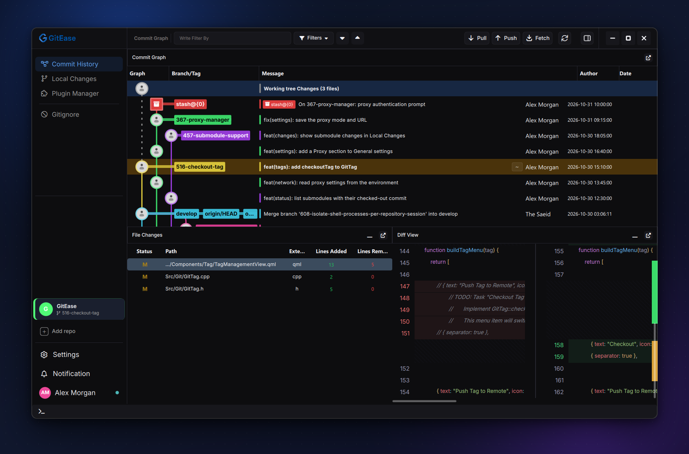
</picture>

## Why GitEase?

Git is powerful, but its best features hide behind commands that are easy to get wrong. GitEase puts them on screen, so you can see what will happen before it happens.

- **Native and light.** Qt 6, QML and C++ on top of libgit2. No Electron, no account, no sign-in.
- **Nothing hidden.** Dialogs preview the exact `git` command they will run, and Recent Activity logs every command GitEase runs.
- **The hard parts, made visual.** Stage a single block of a file, resolve conflicts chunk by chunk, and plan an interactive rebase in a table instead of a TODO file.
- **Make it yours.** Detachable panels, Light, Soft and Dark themes, guided tours, and plugins that add pages, docks, diff viewers, menu items and Git hooks.

## Contents

- [Download](#download)
- [Features](#features): [Commit graph](#commit-graph) · [Local changes](#local-changes) · [Merges and conflicts](#merges-and-conflicts) · [Interactive rebase](#interactive-rebase) · [Remotes, branches and more](#remotes-branches-and-more) · [See every command](#see-every-command) · [Workspace](#workspace)
- [Plugins](#plugins)
- [Command line](#command-line) · [Keyboard shortcuts](#keyboard-shortcuts)
- [Build from source](#build-from-source) · [Architecture](#architecture)
- [Roadmap](#roadmap) · [FAQ](#faq) · [Contributing](#contributing) · [License](#license)

## Download

| Platform | Get it | Notes |
| :-- | :-- | :-- |
| **Windows 10 / 11** (64-bit) | [Download v0.9.0 (.exe)](https://github.com/rasna-io/GitEase/releases/download/v0.9.0/GitEase-V-0.9.0.exe) · [All releases](https://github.com/rasna-io/GitEase/releases) | Installs for the current user, no admin rights needed |
| **Linux** (x86-64, Debian / Ubuntu) | [Download v0.9.0 (.deb)](https://github.com/rasna-io/GitEase/releases/download/v0.9.0/GitEase-0.9.0-Linux.deb) · [All releases](https://github.com/rasna-io/GitEase/releases) | `sudo apt install ./GitEase-*-Linux.deb` |
| **macOS** and other distributions | | [Build from source](#build-from-source) |

GitEase checks for updates when it starts and can download and install a new version for you (**Settings → Updates**).

## Features

### Commit graph

See every branch, merge and tag at a glance, and act on any commit with a right-click.

- Color-coded lanes and labels for branches, tags and remotes, with author avatars.
- Uncommitted changes and stashes show up right in the timeline.
- Search by message, subject, author, email or SHA-1, filter by date range or branch, then jump between matches by commit, author, email, first parent or branch.
- Right-click a commit to check it out, create a branch or tag, merge it, rebase onto it, cherry-pick one or several commits, reset to it (soft, mixed or hard), or browse its files.
- Long histories load page by page. The graph reloads after every change, or only when you ask for very large repositories.

<p align="center">
  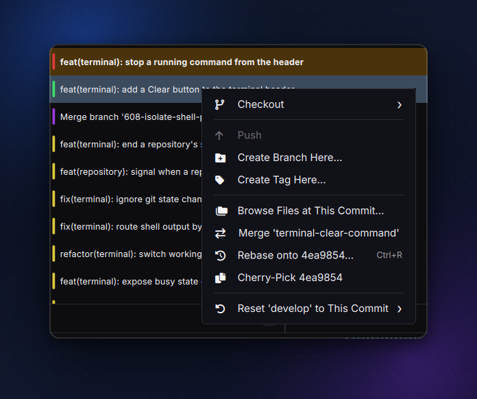
</p>

### Local changes

Commit exactly what you mean, down to a single block of lines.

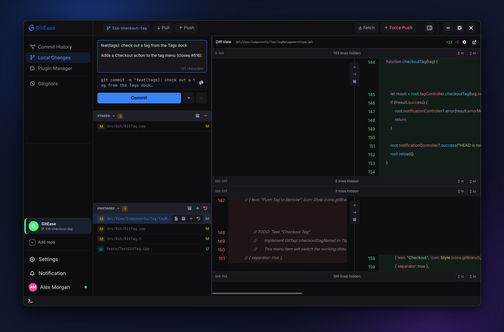

- Staged and unstaged files with one-click stage, unstage, discard and stash, per file or all at once.
- Stage, discard or stash a single block of changes straight from the diff.
- Side-by-side diff with collapsed context you can expand, and a configurable number of context lines.
- Changed pictures, including SVG, can be compared side by side, with a swipe or as an onion skin (with the Image Diff plugin).
- Fix things in place: edit the file in the diff view and save with <kbd>Ctrl</kbd>+<kbd>S</kbd>.
- **Commit**, **Commit & Push**, or **Amend** the last commit, with a live preview of the command.
- Pull, push, fetch and force push from the page header.

### Merges and conflicts

Merge with confidence, and when Git stops on a conflict, work through it one chunk at a time.

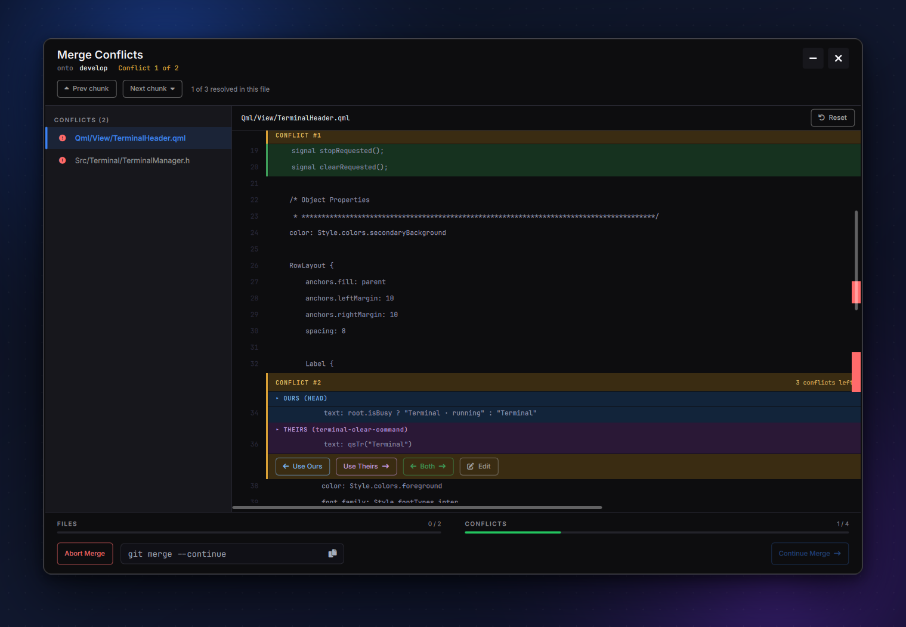

- Merge with or without fast-forward, and optionally delete the branch or push when you're done.
- Conflicts from a merge, cherry-pick or rebase open in a dedicated resolver window.
- For each chunk choose **Use Ours**, **Use Theirs**, keep **Both**, or **Edit** the result by hand.
- Progress bars and scrollbar markers show what's left in each file and overall.
- Plugins can add their own assistant to the conflict window, which suggests a resolution for the current chunk and applies it.
- Continue, skip or abort, with a clear warning before aborting throws away your resolutions.

### Interactive rebase

Clean up history before you share it, without editing a TODO file.

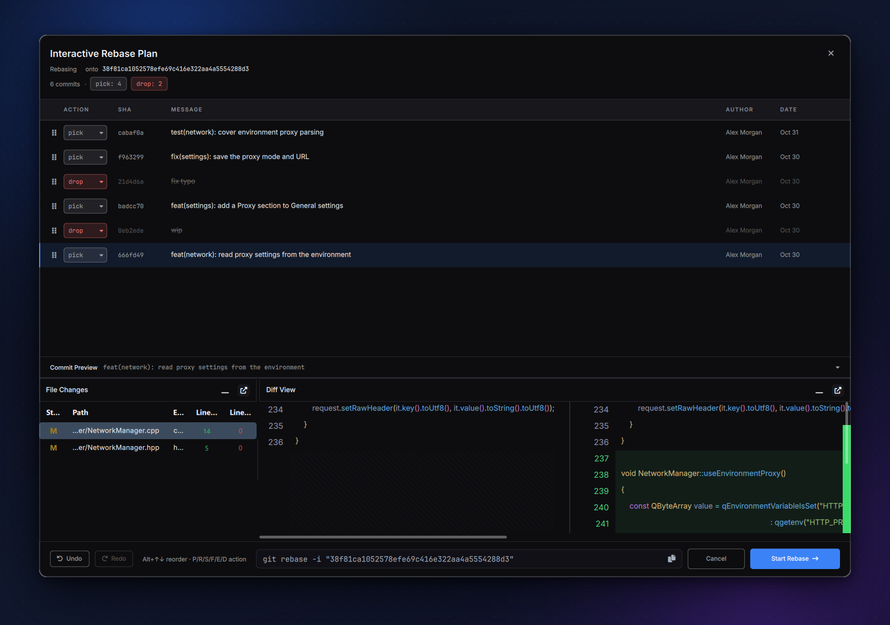

- Open a rebase plan from any commit in the graph (<kbd>Ctrl</kbd>+<kbd>R</kbd>) or from the Rebase dock.
- Choose **pick** or **drop** for each commit (<kbd>P</kbd> / <kbd>D</kbd>).
- Reorder commits by dragging or with <kbd>Alt</kbd>+<kbd>↑</kbd> / <kbd>Alt</kbd>+<kbd>↓</kbd>, with undo and redo.
- Preview the files and diff of every commit before you start.
- Continue, skip, abort or quit a rebase in progress.

### Remotes, branches and more

Everything around your commits lives in the utility panel, one filterable dock per topic.

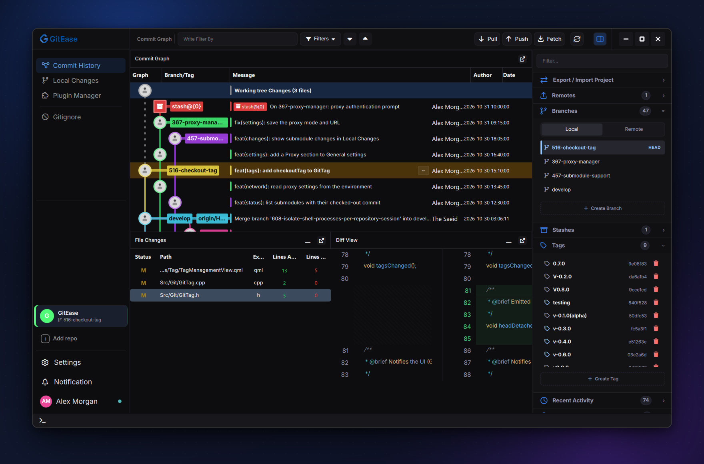

- Clone over HTTPS or SSH (the URL is checked as you type), open existing repositories, and keep several open at once, each with its own color.
- Drag a repository out of the sidebar to open it in its own window.
- Fetch, pull and push with a summary of what changed. Manage remotes, upstreams and a default remote, or choose the remote every time.
- Built-in SSH key manager: generate Ed25519 keys, import or export them, and choose which key to use for GitHub, GitLab (including self-hosted GitLab) and other hosts.
- Docks for branches, tags (lightweight or annotated, pushed to or deleted from the remote) and stashes (everything, a single file, or one block of changes).
- Export and import Git bundles, complete or incremental, to move work between machines without a server.
- Several Git identities: pick the profile used for commits per repository or globally.

### See every command

GitEase never hides what it does to your repository.

<p align="center">
  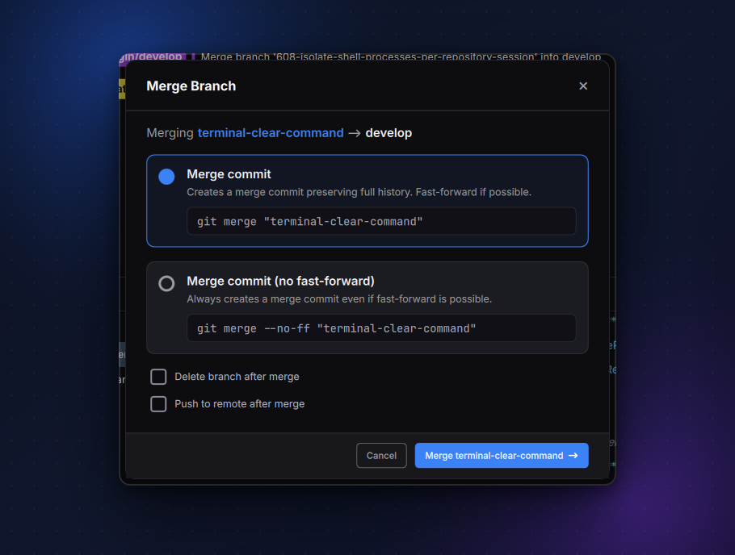
  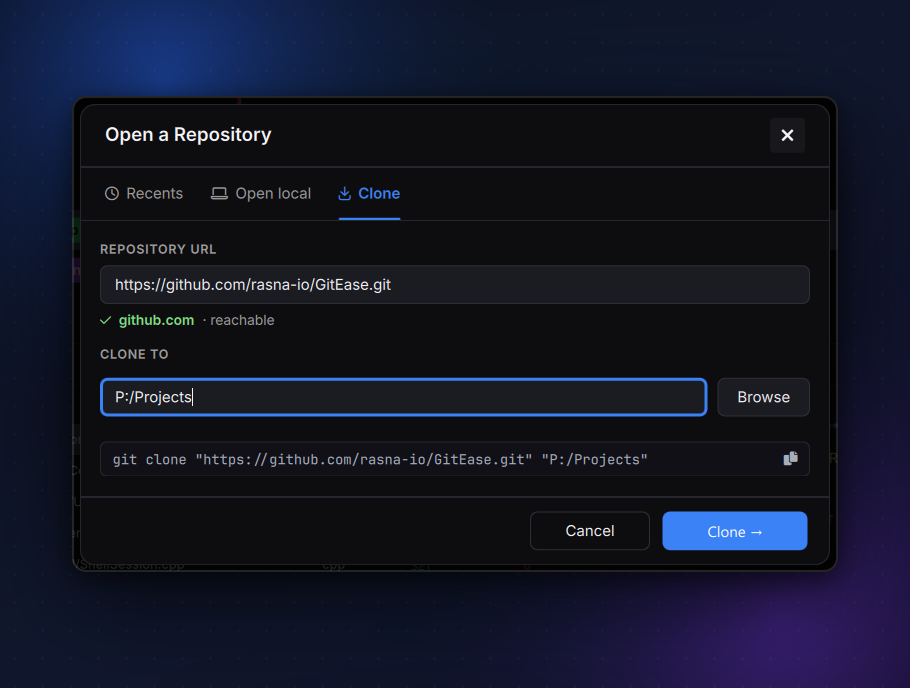
</p>

- Forms preview the exact `git` command they will run. The preview comes from the same code that runs the command, so it can't promise something different.
- Actions you can't undo from inside the app ask first and show the command.
- **Recent Activity** keeps a timestamped log of every command GitEase runs.
- An integrated terminal is one click away: one shell per repository, already in the repository's folder.

### Workspace

Arrange GitEase the way you work.

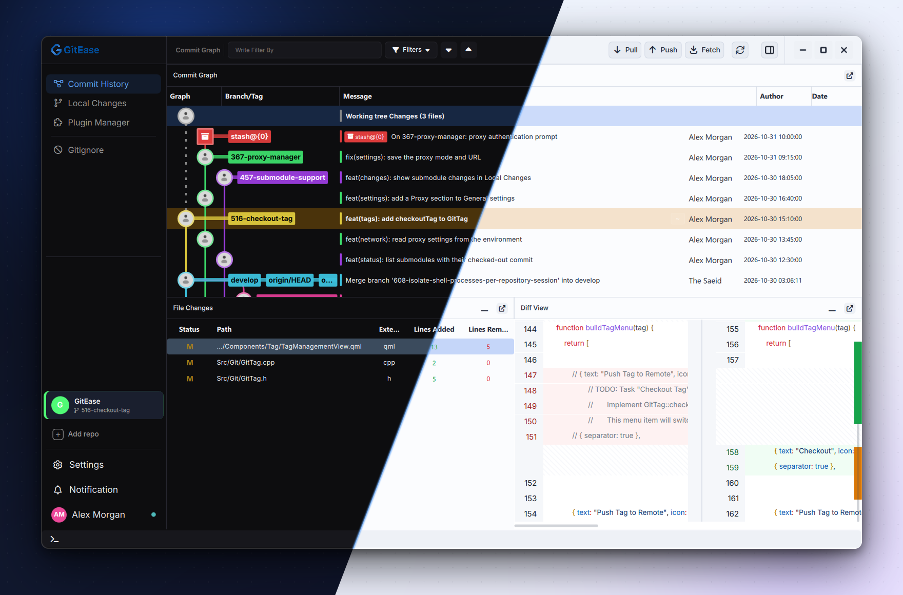

- A utility panel with filterable docks: Remotes, Branches, Stashes, Tags, Recent Activity, Repositories History, Rebase and Export / Import, plus any docks your plugins add.
- Detach the graph, file list, diff or terminal into its own window, or minimize panels to the bottom bar.
- Light, Soft and Dark themes, adjustable font size (<kbd>Ctrl</kbd>+<kbd>=</kbd> / <kbd>Ctrl</kbd>+<kbd>-</kbd>), and a Reduce Motion option.
- Notifications as floating toasts or in the notification center, with a history for each repository.
- Guided tours explain each part of the app the first time you meet it. Replay any of them from **Settings → Help**.

<p align="center">
  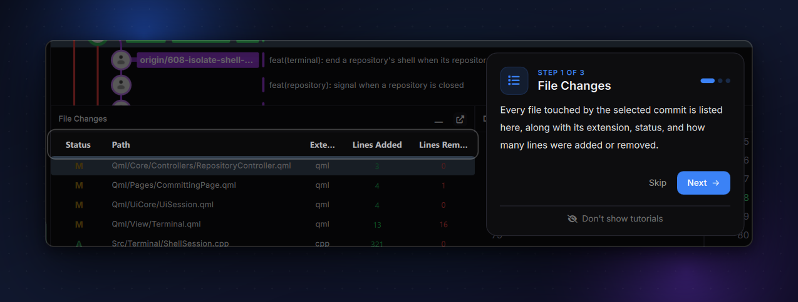
</p>

## Plugins

Plugins can add pages, docks, diff viewers, context-menu items and toolbar buttons, or hook into commits, pushes and merges to check or block them. A plugin is a C++ library or plain QML, shipped as a `.gep` package, and you can enable, disable, update or remove it from the **Plugin Manager** without leaving the app.

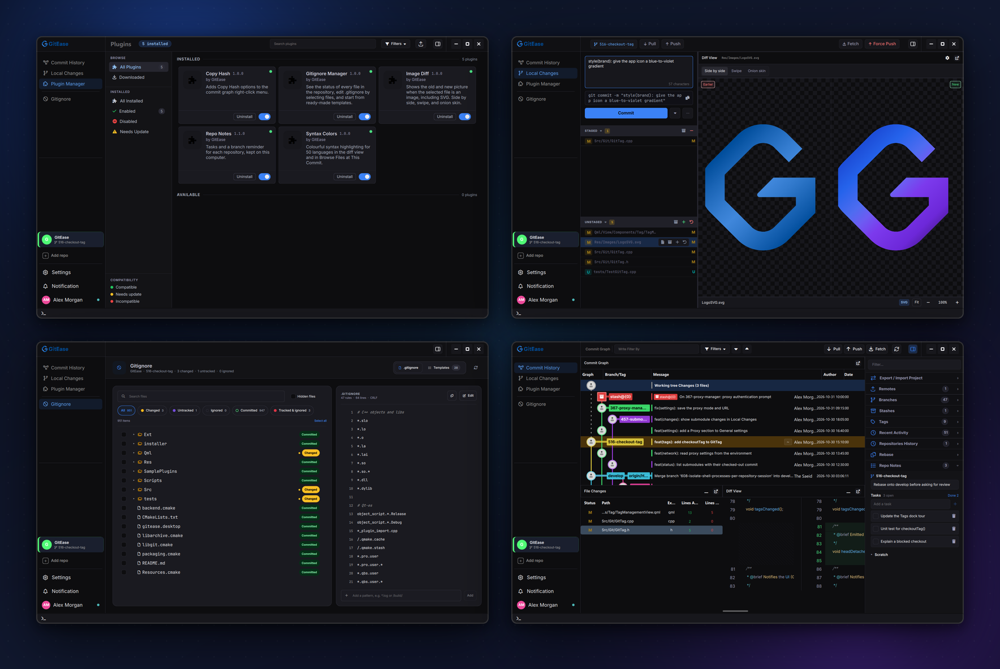

### Example plugins

The [`SamplePlugins`](SamplePlugins) folder holds ready-to-use plugins that double as examples. Gitignore Manager and Syntax Colors also come as prebuilt `.gep` packages.

| Plugin | What it adds | Type |
| :-- | :-- | :-- |
| [Gitignore Manager](SamplePlugins/gitignore-manager) | Every file with its Git status, a `.gitignore` editor and ready-made templates | Page |
| [Syntax Colors](SamplePlugins/syntax-colors) | Syntax highlighting for 50 languages in diffs and *Browse Files at This Commit* | Diff |
| [Image Diff](SamplePlugins/image-diff) | The old and new version of a changed picture, including SVG: side by side, swipe or onion skin | Diff |
| [Repo Notes](SamplePlugins/repo-notes) | A task list and a reminder for the checked-out branch, for each repository | Dock |
| [Commit Guard](SamplePlugins/commit-guard-plugin) | Blocks commits whose message is shorter than 10 characters | Workflow |
| [Copy Hash](SamplePlugins/copy-hash-plugin) | *Copy Hash* items in the commit graph's right-click menu | Context menu |
| [Stats Page](SamplePlugins/stats-page-plugin) | A live statistics page that shows how the plugin event bus works | Page |
| [C++ plugin template](SamplePlugins/cpp-plugin-template) | A starting point for your own plugin | Dock |

To install a package, open **Plugin Manager**, choose **Install plugin from .gep**, and pick the file.

### Write your own

1. Copy [`SamplePlugins/cpp-plugin-template`](SamplePlugins/cpp-plugin-template) and give it your own `id` and `name` in `plugin.json`.
2. Implement `IPlugin` and the interfaces you need, and register them in `initialize()`. The template's dock plugin is the whole pattern:

   ```cpp
   class RepoNotesPlugin : public QObject, public IDockPlugin
   {
       Q_OBJECT
       Q_PLUGIN_METADATA(IID "com.gitease.IDockPlugin/1.0" FILE "plugin.json")
       Q_INTERFACES(IPlugin IDockPlugin)

   public:
       QString id()      const override { return QStringLiteral("com.gitease.repo-notes"); }
       QString name()    const override { return QStringLiteral("Repo Notes"); }
       QString version() const override { return QStringLiteral("1.0.0"); }

       void initialize(IPluginContext* ctx) override { ctx->registerDock(this); }
       void shutdown() override {}

       QString dockTitle() const override { return QStringLiteral("Repo Notes"); }

       // The QML is compiled into the library as a Qt resource
       QUrl dockQmlUrl() const override
       {
           return QUrl(QStringLiteral("qrc:/com.gitease.repo-notes/qml/NotesDock.qml"));
       }
   };
   ```

3. Build it with CMake. Inside this repository the SDK headers in [`Src/Plugins`](Src/Plugins) are found automatically; anywhere else, point CMake at them:

   ```bash
   cmake -S my-plugin -B my-plugin/build -DGITEASE_SDK_DIR=<path to GitEase>/Src/Plugins
   ```

   Each build writes a `.gep` next to `plugin.json` (Python 3 required) and copies the plugin into the `plugins` folder of any GitEase build it finds under `build/`, so you can try it right away.
4. To package a plugin by hand, run `python Scripts/create_gep.py <plugin folder> [output folder]`.

A plugin can also be plain QML with no build step: in `plugin.json`, set `qmlEntry` to your QML file instead of `cppEntry`.

<details>
<summary><b>All extension points</b></summary>
<br>

| Interface | Use it to |
| :-- | :-- |
| `IPagePlugin` | Add a full page to the navigation rail |
| `IDockPlugin` | Add a dock to the utility panel |
| `IDiffPlugin` | Provide a diff viewer or a syntax colorizer for given file extensions |
| `IContextMenuPlugin` | Add items to the commit, branch or file right-click menus |
| `IToolbarPlugin` | Add buttons to the main toolbar |
| `IWorkflowPlugin` | Allow or block `pre-commit`, `pre-push` and `pre-merge`, and react to `post-commit`, `post-fetch` and `post-checkout` |
| `IRulePlugin` | Check an action against your rules before it runs |
| `ICommandPlugin` | Register commands |
| `IConflictAssistPlugin` | Add an assistant to the conflict window that suggests a resolution and applies it |
| `IAuthPlugin` | Provide authentication for the remotes it can handle |
| `IServicePlugin` | Run a background service |
| `IRepositoryAwarePlugin` | Be told when the current repository changes |

Every plugin receives an `IPluginContext` with notifications, per-plugin settings and an event bus (`publish` / `subscribe`).

</details>

## Command line

```text
GitEase --path=<folder> [--init] [--page=<page>] [--stash-pop | --stash-apply | --stash-drop]
```

| Option | What it does |
| :-- | :-- |
| `--path=<folder>` | Opens the repository in `<folder>` and skips the welcome screen |
| `--init` | Used with `--path`: creates a new repository there first |
| `--page=<page>` | Starts on a page: `graph`, `committing`, `plugins`, or the id of a plugin page |
| `--stash-pop`, `--stash-apply`, `--stash-drop` | Pops, applies or drops the most recent stash of the opened repository |

For example, `GitEase --path="C:\code\my-app" --page=committing` opens straight to that repository's local changes.

## Keyboard shortcuts

| Shortcut | Where | Action |
| :-- | :-- | :-- |
| <kbd>Ctrl</kbd>+<kbd>=</kbd> / <kbd>Ctrl</kbd>+<kbd>-</kbd> | Everywhere | Make the text larger / smaller |
| <kbd>↑</kbd> / <kbd>↓</kbd> | Commit graph | Jump to the next / previous commit using the current *Navigate by* rule |
| <kbd>Ctrl</kbd>+<kbd>R</kbd> | Commit graph | Rebase onto the selected commit |
| <kbd>Ctrl</kbd>+<kbd>S</kbd> | Local changes | Save the edits made in the diff view |
| <kbd>P</kbd> / <kbd>D</kbd> | Rebase plan | Pick / drop the selected commit |
| <kbd>Alt</kbd>+<kbd>↑</kbd> / <kbd>Alt</kbd>+<kbd>↓</kbd> | Rebase plan | Move the selected commit up / down |

## Build from source

**Requirements**

- CMake 3.16 or newer, and Ninja (or another CMake generator)
- Qt 6 with Qt Quick, Qt Quick Controls, Qt SVG and Qt Concurrent, plus Qt Test for the unit tests. GitEase is developed against Qt 6.10.
- A C++17 compiler:
  - **Windows:** MinGW 13.1 (64-bit). The prebuilt libgit2, libssh2, OpenSSL and zlib in [`Ext`](Ext) are MinGW libraries, so MSVC builds aren't supported.
  - **Linux:** GCC or Clang.
- Python 3 (optional) to package plugins

**Windows**

```powershell
.\Scripts\Build-Release.ps1             # Release build, deployed to dist\GitEase-Release
.\Scripts\Build-Release.ps1 -Zip        # ...and a .zip of it
.\Scripts\Build-Release.ps1 -Installer  # ...and a Setup.exe (needs Inno Setup 6)
```

The script expects Qt in `C:\Qt\6.10.1\mingw_64` and MinGW in `C:\Qt\Tools\mingw1310_64`; edit the paths at the top of the script to match your setup. Deployment also copies the Visual C++ runtime that `archive.dll` needs from your Visual Studio installation.

**Linux**

```bash
./Scripts/build.sh    # builds build/release and creates a .deb
```

The script uses the newest Qt it finds under `~/Qt` or `/opt/Qt`; set `QT_PATH` (for example `QT_PATH=~/Qt/6.10.1`) to choose one.

**Any platform, step by step**

```bash
cmake -S . -B build -G Ninja -DCMAKE_BUILD_TYPE=Release -DCMAKE_PREFIX_PATH=<Qt>/6.10.x/<kit>
cmake --build build
ctest --test-dir build --output-on-failure
```

On Windows, also pass `-DCMAKE_CXX_COMPILER=<MinGW>/bin/g++.exe`, and put Qt's and MinGW's `bin` folders on `PATH` to run `build\GitEase.exe` straight from the build folder. Debug builds turn off QML cache generation so that QML Preview works.

## Architecture

GitEase is a Qt Quick application on top of a C++ core.

<p align="center">
  <picture>
    <source media="(prefers-color-scheme: dark)" srcset="docs/images/architecture/architecture-dark.svg">
    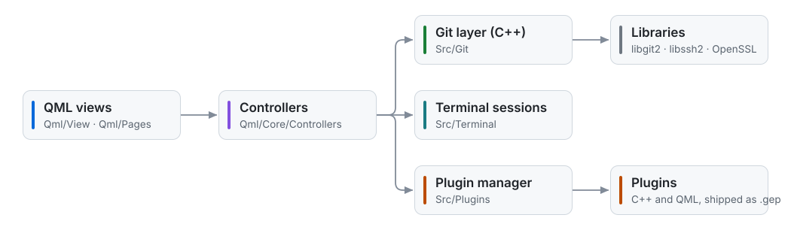
  </picture>
</p>

- **Views** render the UI with GitEase's own control style ([`Qml/Style`](Qml/Style)).
- **Controllers** hold each window's state and report every Git command they run, which feeds the command previews and Recent Activity.
- **The Git layer** wraps libgit2. Slow operations run on worker threads ([`Src/Git/Async`](Src/Git/Async)) so the window stays responsive.
- **Plugins** load from the app-data folder and from a `plugins` folder next to the executable, and reach the host only through `IPluginContext`.

```text
GitEase/
├── Src/             C++ core: Git layer, plugin manager, terminal, utilities
├── Qml/             UI: pages, views, popups, controllers and style
├── Res/             Fonts, icons and images
├── Ext/             Prebuilt libgit2, libssh2, OpenSSL, zlib and libarchive
├── SamplePlugins/   Example plugins and the C++ plugin template
├── Scripts/         Build, packaging and plugin tools
├── installer/       Inno Setup script for the Windows installer
├── tests/           Qt Test unit tests, run with ctest
└── docs/images/     README images: brand, overview, git, workspace, plugins, architecture
```

## Roadmap

Planned and in-progress work, tracked in the [issues](https://github.com/rasna-io/GitEase/issues):

- Reword, edit, squash and fixup in the interactive rebase plan
- Git worktrees (the UI is in progress)
- Creating a new repository from the *Add repository* dialog (already available with `--init`)
- Git submodules ([#457](https://github.com/rasna-io/GitEase/issues/457))
- Proxy settings ([#367](https://github.com/rasna-io/GitEase/issues/367))
- Checking out tags ([#516](https://github.com/rasna-io/GitEase/issues/516))
- Saving and resuming a conflict resolution ([#253](https://github.com/rasna-io/GitEase/issues/253))
- AppImage builds for more Linux distributions ([#428](https://github.com/rasna-io/GitEase/issues/428))
- AI-assisted commit messages ([#563](https://github.com/rasna-io/GitEase/issues/563))

## FAQ

<details>
<summary><b>Is GitEase free?</b></summary>
<br>
Yes. GitEase is free to download and use, and it doesn't need an account.
</details>

<details>
<summary><b>Does it work with GitHub, GitLab, Bitbucket or my own server?</b></summary>
<br>
Yes. GitEase works with any Git remote over HTTPS or SSH. The SSH key manager has shortcuts for GitHub and GitLab and a setting for every other host.
</details>

<details>
<summary><b>Do I need Git installed?</b></summary>
<br>
Not for most features: GitEase works with your repositories through libgit2. Install Git if you want to run <code>git</code> commands in the integrated terminal.
</details>

<details>
<summary><b>Does GitEase run my repository's Git hooks?</b></summary>
<br>
No. Commits and pushes go through libgit2, which doesn't run the scripts in <code>.git/hooks</code>. To check or block commits, pushes and merges, use a workflow plugin (<code>IWorkflowPlugin</code>), which can allow or stop <code>pre-commit</code>, <code>pre-push</code> and <code>pre-merge</code>.
</details>

<details>
<summary><b>Where are my settings and plugins stored?</b></summary>
<br>
In <code>%APPDATA%\GitEase</code> on Windows and <code>~/.local/share/GitEase</code> on Linux. Installed plugins live in the <code>plugins</code> folder inside it.
</details>

<details>
<summary><b>Is there a macOS version?</b></summary>
<br>
Not yet. There's no macOS package, and macOS builds aren't tested. Contributions are welcome.
</details>

## Contributing

Bug reports, ideas, documentation and code are all welcome.

1. Find or open an [issue](https://github.com/rasna-io/GitEase/issues). Issues labeled [good first issue](https://github.com/rasna-io/GitEase/labels/good%20first%20issue) are a good place to start.
2. Create a branch from `develop`. `main` only receives releases.
3. Keep the change focused, build it, and run `ctest`.
4. Open a pull request against `develop` that explains the problem, the change, and how you tested it.

The repository's own rules live in [`.gitease/rules.json`](.gitease/rules.json):

- **Commit messages** follow [Conventional Commits](https://www.conventionalcommits.org): `type(scope): summary`, 10 to 72 characters, in the imperative mood and without a trailing period. For example: `feat(terminal): end a repository's shell when its repository is closed`.
- **Branch names** start with `feature/`, `bugfix/`, `hotfix/`, `release/`, `chore/` or `docs/`, use lowercase kebab-case, and are at most 50 characters long. Including the issue number helps, for example `feature/516-checkout-tag`.
- `main`, `develop` and `release/*` are protected: no force pushes.
- No secrets, private keys or files larger than 10 MB.

## License

> [!IMPORTANT]
> This repository doesn't include a license yet. Until the maintainers add one, please open an issue before reusing or redistributing the code.

## Acknowledgments

GitEase is built on:

- [Qt](https://www.qt.io) for the UI framework
- [libgit2](https://libgit2.org), [libssh2](https://libssh2.org), [OpenSSL](https://www.openssl.org) and [zlib](https://zlib.net) for Git and networking
- [libarchive](https://libarchive.org) for archive support
- [Inter](https://rsms.me/inter/) and [JetBrains Mono](https://www.jetbrains.com/lp/mono/) for type, and [Font Awesome](https://fontawesome.com) for icons

Thanks to everyone who has contributed:

<a href="https://github.com/rasna-io/GitEase/graphs/contributors">
  
</a>

<br>
<br>

<div align="center">

[gitease.app](https://gitease.app) · [Releases](https://github.com/rasna-io/GitEase/releases) · [Issues](https://github.com/rasna-io/GitEase/issues)

</div>
