# GitEase Software Architecture

| | |
| :-- | :-- |
| **Version** | 1.0 |
| **Date** | 2 November 2026 |
| **Describes** | The `develop` branch at commit `ae077207` (GitEase 0.9.0) |
| **Related documents** | [README](../README.md) (features, download, build) |

This document explains how GitEase is built: its parts, how they work together, where each feature lives in the code, and how anyone can extend GitEase with a plugin.

All diagrams are written in [Mermaid](https://mermaid.js.org) and use UML notation (class, sequence, state and component diagrams). GitHub and GitLab draw them directly from this file.

> [!NOTE]
> Some extension points are declared in the plugin SDK but the app doesn't call them yet. Tables in this document mark every item with one of these labels:
>
> - **Working**: the app uses it today.
> - **Partial**: the app uses some of it.
> - **Declared**: it is in the SDK headers, but the app never calls it.

## Contents

1. [Introduction](#1-introduction)
2. [Goals and constraints](#2-goals-and-constraints)
3. [System context](#3-system-context)
4. [Architecture overview](#4-architecture-overview)
5. [Startup](#5-startup)
6. [The application core](#6-the-application-core)
7. [Features: where they live](#7-features-where-they-live)
8. [Plugin architecture](#8-plugin-architecture)
9. [Build your own plugin](#9-build-your-own-plugin)
10. [Build and deployment](#10-build-and-deployment)
11. [Glossary](#11-glossary)

---

## 1. Introduction

### 1.1 Who this is for

| Reader | Read |
| :-- | :-- |
| GitEase developers | Sections 2 to 8 and 10 |
| Plugin authors: the GitEase team, customers and third parties | Section 8 (how plugins work) and section 9 (step-by-step guide) |

### 1.2 Scope

This document covers the desktop app (C++ core and QML interface), the plugin SDK and the code that hosts plugins, the sample plugins, and the build and packaging scripts.

It doesn't cover the plugin marketplace server or the update server. It describes only what the app sends to them and expects back.

---

## 2. Goals and constraints

### 2.1 Quality goals

| Goal | What it means for the architecture |
| :-- | :-- |
| **Responsive** | The UI thread never waits for the network or for a slow disk. Git work runs on worker threads ([`GitAsyncRunner`](../Src/Git/Async/GitAsyncRunner.h)). Plugin scans, installs and uninstalls run on a separate worker thread. |
| **Nothing hidden** | Every Git operation reports the `git` command it matches. The preview in a form and the text in Recent Activity come from the same function ([`GitCommandText`](../Src/Git/GitCommandText.h)), so they can't disagree. |
| **Safe with your repository** | Work on one repository runs one job at a time. Results that arrive after you switch repository are dropped. Plugins can check or block an action before it runs. |
| **Extensible** | Plugins add pages, docks, diff viewers, menu items and toolbar buttons, and hook into commits, pushes and merges, without changes to the core. |
| **Native and light** | Qt Quick and C++ on top of libgit2. No web runtime. |
| **Windows and Linux first** | Same code on both. macOS paths exist in the code but aren't tested. |

### 2.2 Constraints

- **Qt 6** (developed with 6.10), **C++17**, **CMake 3.16** or newer.
- **Windows builds use MinGW 13.1 (64-bit).** The prebuilt libraries in [`Ext`](../Ext) are MinGW libraries, so MSVC isn't supported. C++ plugins must be built with the same compiler and the same Qt version as the app (see [9.11](#911-compatibility-rules)).
- **libgit2 doesn't run the scripts in `.git/hooks`.** Checks before a commit or push are done by plugins instead ([`IWorkflowPlugin`](../Src/Plugins/IWorkflowPlugin.h) and [`IRulePlugin`](../Src/Plugins/IRulePlugin.h)).

---

## 3. System context

GitEase is a desktop app. It works with local repositories, talks to Git hosts, and loads plugins into its own process.

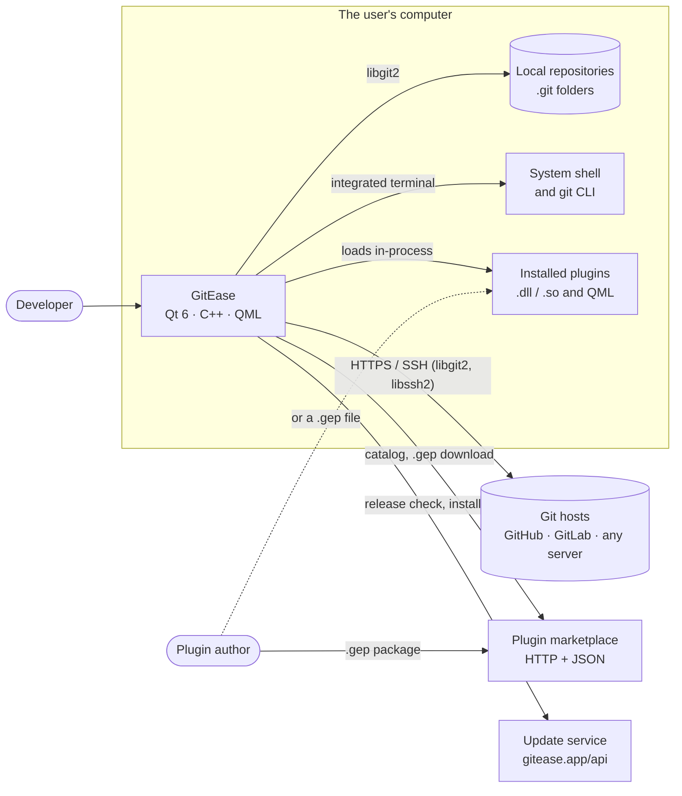

| External system | How GitEase talks to it | Code |
| :-- | :-- | :-- |
| Local repositories | libgit2, in process | [`Src/Git`](../Src/Git) |
| Git hosts | libgit2 over HTTPS (token) or SSH (libssh2 and the keys from the SSH key manager) | [`GitRemote`](../Src/Git/GitRemote.h), [`Src/Git/Auth`](../Src/Git/Auth) |
| System shell | One shell process per open repository | [`TerminalManager`](../Src/Terminal/TerminalManager.h), [`ShellSession`](../Src/Terminal/ShellSession.h) |
| Plugin marketplace | JSON over HTTP through `NetworkManager`. The address is still a placeholder (`http://localhost/api`). | [`PluginController.qml`](../Qml/Core/Controllers/PluginController.qml) |
| Update service | JSON over HTTPS at `https://gitease.app/api`. Downloads and starts the installer. | [`UpdateController.qml`](../Qml/Core/Controllers/UpdateController.qml), [`UpdateManager`](../Src/Utilities/UpdateManager/UpdateManager.hpp) |

---

## 4. Architecture overview

### 4.1 Layers

GitEase has four layers. Each layer talks only to the layer below it. Plugins sit beside the core and reach it through one interface.

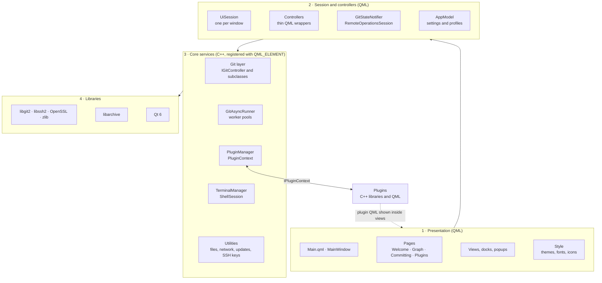

| Layer | What it does | Rules |
| :-- | :-- | :-- |
| **1 · Presentation** | Draws the windows with GitEase's own control style ([`Qml/Style`](../Qml/Style)). | Views never call libgit2. They call controllers and read their results. |
| **2 · Session and controllers** | [`UiSession`](../Qml/UiCore/UiSession.qml) creates every controller for one window and wires them together. | A controller is usually a thin QML type on top of a C++ class (see [6.1](#61-uisession-and-controllers)). |
| **3 · Core services** | All Git work, threading, plugin hosting, terminals and system helpers. | Every Git method returns a [`GitResult`](../Src/Git/GitResult.h) and reports its `git` command. |
| **4 · Libraries** | Git, transport, crypto, archives, UI framework. | Prebuilt in [`Ext`](../Ext), linked by [`libgit.cmake`](../libgit.cmake) and [`libarchive.cmake`](../libarchive.cmake). |

### 4.2 Source tree

```text
GitEase/
├── Src/                         C++ core
│   ├── main.cpp                 Starts libgit2, Qt and the QML engine
│   ├── Git/                     Git layer: one controller class per topic
│   │   ├── Async/               GitAsyncRunner: worker threads for Git calls
│   │   ├── Auth/                IGitAuth, HTTPS and SSH authentication
│   │   ├── Models/              Repository, Commit, GitDiff, GitFileStatus, Remote, Config
│   │   └── Utilities/           Protocol detection, .gitignore matching
│   ├── Plugins/                 Plugin SDK headers (I*.h) and the plugin host
│   ├── Terminal/                One shell session per repository
│   └── Utilities/               FileIO, NetworkManager, UpdateManager, SshKeyManager,
│                                TextDirectionManager, window helpers
├── Qml/
│   ├── Main.qml                 First window, creates the UiSession
│   ├── UiCore/                  UiSession, its popups, RemoteOperationsSession
│   ├── Core/
│   │   ├── Controllers/         30 controllers (most wrap a C++ class)
│   │   ├── Models/              AppModel, settings, Repository, Plugin, UserProfile
│   │   ├── Services/            GitStateNotifier
│   │   └── Scripts/             JS helpers: AsyncGit, graph layout, menu builders
│   ├── Pages/                   Welcome, Graph, Committing, Plugins
│   ├── View/                    MainWindow, header, terminal, components, popups
│   └── Style/                   Themes (Light, Soft, Dark), fonts, icons, controls
├── Res/                         Fonts, icons, images (QML module GitEase.Resources)
├── Ext/                         Prebuilt libgit2, libssh2, OpenSSL, zlib, libarchive
├── SamplePlugins/               Example plugins, the C++ template, PackageGep.cmake
├── Scripts/                     Build scripts and create_gep.py
├── installer/                   Inno Setup script for Windows
└── tests/                       Qt Test unit tests (ctest)
```

### 4.3 Key design decisions

| # | Decision | Why | What it means for you |
| :-- | :-- | :-- | :-- |
| 1 | QML interface on a C++ core, joined with `QML_ELEMENT` | Native speed, and the interface is easy to change | Every C++ class marked `QML_ELEMENT` is available in the `GitEase` QML module. |
| 2 | libgit2 instead of calling the `git` program | Works without Git installed, returns structured data | `.git/hooks` don't run. Plugins do the checks instead. |
| 3 | One `UiSession` per window | Each window keeps its own state | Opening a repository in its own window starts a new process with `--path` ([`TaskbarHelper`](../Src/Utilities/windowsManager/TaskbarHelper.cpp)). |
| 4 | Any Git method can run on a worker thread by name (`callAsync`) | No extra code per operation | A new `Q_INVOKABLE` method can be called asynchronously right away. Methods that use the network must be added to one table (see [6.3](#63-threads-and-the-async-runner)). |
| 5 | One work queue ("lane") per repository, and two thread pools | A `git_repository` handle isn't thread-safe, and a fetch can hang | Reads stay fast while a fetch to a slow server is running. |
| 6 | One function builds every command text | The preview must match what runs | Every new Git operation needs a function in `GitCommandText`. |
| 7 | The plugin interface is pure virtual and only grows at the end | Plugin libraries don't link against the app, so they keep working across versions | Never reorder or remove methods in `IPluginContext`. Add new ones at the end. |
| 8 | Plugins run in the app's process, with full trust | Simple and fast | A broken plugin can crash GitEase. |
| 9 | Plugin libraries load from a copy (a "hot copy") | Windows locks a loaded `.dll` | Plugins can be updated and removed without restarting GitEase. |
| 10 | One "repository changed" broadcast ([`GitStateNotifier`](../Qml/Core/Services/GitStateNotifier.qml)) | Views don't need to know about each other | After any change, every view reloads once. |

---

## 5. Startup

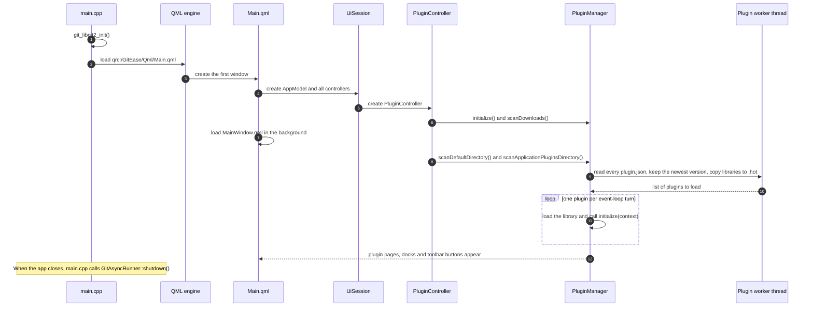

- [`main.cpp`](../Src/main.cpp) only starts libgit2, Qt and the QML engine. Everything else is created from QML.
- [`ShellController`](../Qml/Core/Controllers/ShellController.qml) reads the [command-line options](../README.md#command-line) (`--path`, `--init`, `--page`, `--stash-pop`, `--stash-apply`, `--stash-drop`).
- Plugins are scanned one event-loop turn after the window is ready, so page plugins can add themselves to the navigation rail.

---

## 6. The application core

### 6.1 UiSession and controllers

[`UiSession`](../Qml/UiCore/UiSession.qml) is the root object of a window. It creates every controller once and connects them.

A controller is usually a QML type that extends a C++ class. The C++ class does the Git work. The QML file can add small helpers for the interface:

```qml
// Qml/Core/Controllers/CommitController.qml: all the work is in C++
GitCommit {
}

// Qml/Core/Controllers/StashController.qml: adds one helper on top of the C++ class
GitStash {
    property StatusController statusController
    function stashLines(filePath, startLine, endLine, mode) { ... }
}
```

| QML controller | C++ class | What it does |
| :-- | :-- | :-- |
| RepositoryController | `GitRepository` | Open, clone and init repositories. Holds the current repository. |
| StatusController | `GitStatus` | Working-tree status, staging, line-level stage and discard, diffs |
| CommitController | `GitCommit` | Commit history, commit, amend |
| BranchController | `GitBranch` | Create, rename, delete and check out branches |
| RemoteController | `GitRemote` | Remotes, fetch, pull, push, upstreams |
| MergeController | `GitMerge` | Merge with or without fast-forward |
| ConflictController | `GitConflict` | Conflicted files, regions, resolution |
| RebaseController | `GitRebase` | Rebase onto, interactive rebase plan, continue, skip, abort |
| CherryPickController | `GitCherryPick` | Cherry-pick one or many commits |
| ResetController | `GitReset` | Soft, mixed and hard reset |
| StashController | `GitStash` | Stash all, one file or selected lines |
| TagController | `GitTag` | Tags, push and delete on a remote |
| BundleController | `GitBundle` | Create and import bundles |
| ConfigController | `GitConfig` | Git config, user identity |
| IgnoreController | `GitIgnore` | `.gitignore` reading and matching |
| GitTreeController | `GitTree` | Files at a commit, file contents, images for the image diff |
| TerminalController | `TerminalManager` | Integrated terminal, one shell per repository |
| SshKeyController | `SshKeyManager` | Generate, import, export and choose SSH keys |
| NetworkController | `NetworkManager` | HTTP requests and downloads |
| UpdateController | `UpdateManager` | Update check, download and install |
| TextDirectionController | `TextDirectionManager` | Keeps editors left-to-right with right-to-left keyboard layouts |
| PluginController | (owns a `PluginManager`) | Plugin Manager page, marketplace, install and uninstall |
| ActivityController, NotificationController, GuideController, LayoutController, DockController, UserProfileController, WelcomeController, ShellController | none (pure QML) | Recent Activity, notifications, guided tours, layout, docks, identity profiles, welcome screen, command line |

The session connects controllers in three ways:

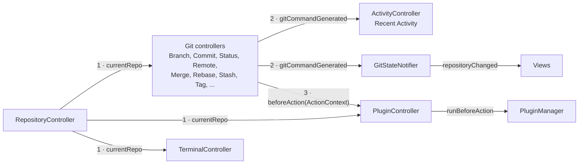

1. **Current repository.** When the user switches repository, `RepositoryController` hands the new `Repository` to every controller.
2. **Commands.** Every controller reports the `git` command it ran. The session adds it to Recent Activity and to `GitStateNotifier`.
3. **Rule checks.** `CommitController`, `BranchController`, `RemoteController` and `MergeController` ask plugins to check an action before it runs (see [8.4](#84-extension-points) and [7.1](#71-commit-step-by-step)).

### 6.2 The Git layer

All Git work goes through [`IGitController`](../Src/Git/IGitController.h). Each topic (branches, commits, remotes and so on) is one subclass.

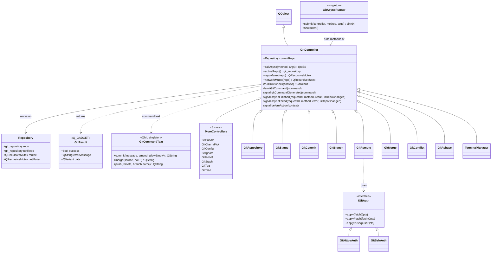

**Rules every controller follows**

- Public operations are `Q_INVOKABLE` and return a `GitResult`. QML checks `result.success` and shows `result.errorMessage`.
- Use `activeRepo()` for every libgit2 call. It returns the handle the async runner bound for this job, or the main handle when the call came from the UI thread.
- After a successful change, call `emitGitCommand(GitCommandText::...)` so Recent Activity and the refresh logic see it.
- Before an action that plugins may block, build an `ActionContext` and call `runRuleCheck()` (see [8.4](#84-extension-points)).

[`Models`](../Src/Git/Models) holds the value types passed to QML: `Commit`, `GitDiff`, `GitFileStatus`, `Remote` and `Config` (all `Q_GADGET`), plus `Repository`, which owns the libgit2 handles.

### 6.3 Threads and the async runner

[`GitAsyncRunner`](../Src/Git/Async/GitAsyncRunner.h) runs controller methods on worker threads.

- **Two pools.** The *local* pool (2 to 8 threads, half the CPU threads) runs reads, commits, stashes, tags and pull. The *network* pool (4 threads) runs `clone`, `fetch`, `fetchWithToken`, `push`, `pushTag` and `pushDeleteTag`. A fetch that hangs on an unreachable server can only fill the network pool, so opening and reading repositories always works.
- **One lane per repository.** Jobs for one repository run one at a time, in order. Jobs for different repositories run side by side.
- **Two handles per repository.** Transfers use a second handle (`netRepo`) with its own lock, so reading a repository isn't blocked while it pushes or fetches.
- **Stale results are dropped.** Each controller counts repository changes. A result for a repository the user has already left is reported as `"stale"` instead of being shown.

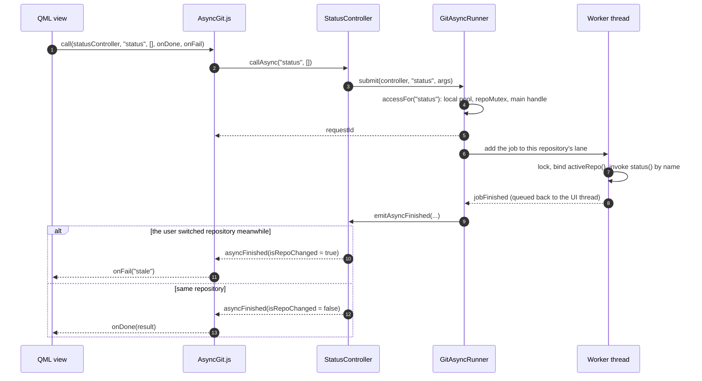

In QML, use the [`AsyncGit.js`](../Qml/Core/Scripts/AsyncGit.js) helper:

```js
AsyncGit.call(commitController, "getCommits", [200, 0], function (result) {
    if (result.success)
        graph.append(result.data)
}, function (error) {
    // error is "stale" when the repository changed meanwhile
})
```

**When you add a Git operation**

1. Add a `Q_INVOKABLE` method to the right controller. It can now be called both ways: directly and with `callAsync`.
2. If it talks to a remote, add its name to the network list in `GitAsyncRunner::accessFor()`.
3. Rule checks only run on the UI thread. Calls on a worker thread skip them. If plugins must be able to block the operation, add a check method that the UI calls first, as push does with `GitRemote::checkPushRules()`.

### 6.4 Showing every command

GitEase shows the `git` command behind each action, before it runs (preview) and after it runs (Recent Activity).

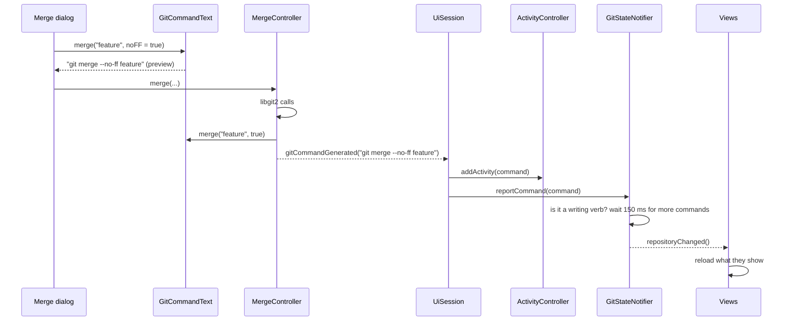

- [`GitCommandText`](../Src/Git/GitCommandText.h) is a QML singleton. Forms call it for the preview. Controllers call the same function after the operation.
- [`GitStateNotifier`](../Qml/Core/Services/GitStateNotifier.qml) knows which verbs write to the repository (`commit`, `merge`, `push`, `stash` and so on) and which arguments make them read-only (`git branch -a`). It turns a burst of commands into one `repositoryChanged()`.
- Commands typed in the integrated terminal raise the same signal through `TerminalManager.gitStateChanged`.

### 6.5 Authentication

| Part | What it does |
| :-- | :-- |
| [`IGitAuth`](../Src/Git/Auth/IGitAuth.h) | Sets libgit2 credential callbacks on fetch and push options |
| [`GitSshAuth`](../Src/Git/Auth/GitSshAuth.h) | SSH keys from the SSH key manager, per host (GitHub, GitLab, others), plus the system SSH agent |
| [`GitHttpsAuth`](../Src/Git/Auth/GitHttpsAuth.h) | HTTPS with a personal access token |
| [`RemoteOperationsSession`](../Qml/UiCore/RemoteOperationsSession.qml) | Runs fetch, pull and push for the interface. Asks for a token with `UserAuthenticationPopup` when needed. Explains failures with [`RemoteErrorGuide.js`](../Qml/Core/Scripts/RemoteErrorGuide.js). |

HTTPS tokens aren't stored. The user enters one for every remote operation.

### 6.6 Terminal

[`TerminalManager`](../Src/Terminal/TerminalManager.h) gives every open repository its own shell ([`ShellSession`](../Src/Terminal/ShellSession.h)).

- The shell starts in the repository's folder the first time the user sends a command there.
- Output is tagged with the session it came from, so a long command in one repository never mixes into another.
- `git` commands get `-c color.ui=always`. Commands that change the repository raise `gitStateChanged`.
- When a repository is closed, its shell ends after the running command finishes.

### 6.7 Utilities

| Class | What it does |
| :-- | :-- |
| [`FileIO`](../Src/Utilities/FileManager/FileIO.hpp) | Reads and writes files for QML. Knows the config folder. |
| [`NetworkManager`](../Src/Utilities/NetworkManager/NetworkManager.hpp) | HTTP requests and downloads, identified by a request key |
| [`UpdateManager`](../Src/Utilities/UpdateManager/UpdateManager.hpp) | Saves a downloaded installer and starts it |
| [`SshKeyManager`](../Src/Utilities/SshKeyManager/SshKeyManager.h) | Ed25519 key generation, import, export, rename |
| [`TextDirectionManager`](../Src/Utilities/TextDirectionManager/TextDirectionManager.h) | Keeps code editors left-to-right with Persian or Arabic keyboard layouts |
| [`WindowController`](../Src/Utilities/windowsManager/windowcontroller.hpp), `BorderlessWindowHelper`, [`TaskbarHelper`](../Src/Utilities/windowsManager/TaskbarHelper.hpp) | Custom window frame, taskbar color per repository, opening a repository in a new window. Mostly Windows-specific. |

### 6.8 Where data is stored

`<AppData>` is `%APPDATA%\GitEase` on Windows and `~/.local/share/GitEase` on Linux.

| Data | Location | Format |
| :-- | :-- | :-- |
| Repositories, recent list, identity profiles, settings, enabled plugin ids | `<AppData>/GitEase.json` ([`AppModel`](../Qml/Core/Models/AppModel.qml)) | JSON |
| Plugin settings (`setting()` / `setSetting()`) | `QSettings("GitEase", "PluginSettings")`: the registry on Windows (`HKCU\Software\GitEase\PluginSettings`), `~/.config/GitEase/PluginSettings.conf` on Linux | Key `pluginId/key` |
| Installed plugins | `<AppData>/plugins/<id>-<version>-<timestamp>/` | Folder with `plugin.json` |
| Plugins shipped with the app | `<install folder>/plugins/` | Same |
| Downloaded packages | `<AppData>/downloads/plugins/<slug>-<version>.gep` | ZIP |
| Repository rules (Organization Rules plugin) | `<repository>/.gitease/rules.json` | JSON |

---

## 7. Features: where they live

This table maps each feature from the [README](../README.md#features) to its code. "Plugin hooks" lists the extension points a plugin can use there (see [8.4](#84-extension-points)).

| Feature | Interface (QML) | Controllers | C++ core | Plugin hooks |
| :-- | :-- | :-- | :-- | :-- |
| Open, clone, init, recent repositories | [`WelcomePage`](../Qml/Pages/WelcomePage.qml), [`View/Components/Repository`](../Qml/View/Components/Repository), `RepositorySelectorPopup` | RepositoryController, WelcomeController | `GitRepository`, `GitProtocolDetector` | `IRepositoryAwarePlugin`, event `repo.switched` |
| Several repositories, one window each | `RepositoriesSidebar`, `MainWindow` | RepositoryController, ShellController | `TaskbarHelper` (`--path`) | |
| Commit graph, search, filters | [`GraphViewPage`](../Qml/Pages/GraphViewPage.qml), [`CommitGraphDock`](../Qml/View/Components/Docks/CommitGraphDock.qml), [`View/Components/GraphView`](../Qml/View/Components/GraphView), `GraphLayout.js`, `CommitGraphDataLoader.js`, `CommitGraphFilter.js`, `CommitGraphNavigation.js` | CommitController, BranchController | `GitCommit`, `GitBranch` | `IContextMenuPlugin` (commit menu) |
| Commit actions: checkout, branch, tag, cherry-pick, reset | `CommitGraphMenuBuilder.js`, popups | BranchController, TagController, CherryPickController, ResetController | `GitBranch`, `GitTag`, `GitCherryPick`, `GitReset` | `IRulePlugin` (branch create, checkout) |
| Browse files at a commit | `CommitFileBrowserPopup` | GitTreeController | `GitTree` | `IDiffPlugin` colorizer |
| Local changes, line-level staging | [`CommittingPage`](../Qml/Pages/CommittingPage.qml), [`View/Components/FileLists`](../Qml/View/Components/FileLists), `FileChangesDock` | StatusController, StashController | `GitStatus`, `GitStash` | |
| Commit, amend | `CommittingPage`, `CommitAmendPopup` | CommitController | `GitCommit` | `IWorkflowPlugin` (`pre-commit`, `post-commit`), `IRulePlugin` (commit message) |
| Diff, edit in the diff | [`DiffView`](../Qml/View/Components/Diff/DiffView.qml), `StackedDiff`, `DiffScrollBar` | StatusController | `GitStatus`, `GitDiff` | `IDiffPlugin` colorizer |
| Image diff | [`ImageDiffHost`](../Qml/View/Components/Diff/ImageDiffHost.qml) | GitTreeController | `GitTree` | `IDiffPlugin` viewer (Image Diff plugin) |
| Merge | `MergeMethodPopup` | MergeController | `GitMerge` | `IRulePlugin` (after merge) |
| Conflicts | [`ConflictPopup`](../Qml/View/Popups/ConflictPopup.qml), [`View/Components/Conflict`](../Qml/View/Components/Conflict) | ConflictController | `GitConflict` | `IConflictAssistPlugin` |
| Rebase, interactive rebase plan | `RebaseDock`, [`View/Components/Rebase`](../Qml/View/Components/Rebase), `CommitPlanPopup` | RebaseController | `GitRebase` | |
| Remotes, fetch, pull, push | `RemoteView`, `AddEditRemotePopup`, `FetchSummaryPopup`, `RemoteTargetPopup`, `UserAuthenticationPopup` | RemoteController, [`RemoteOperationsSession`](../Qml/UiCore/RemoteOperationsSession.qml) | `GitRemote`, `Auth/*` | `IRulePlugin` (push) |
| Branches | `BranchManagementView`, `BranchesList`, `AddBranchPopup`, `CheckoutBranchSelectorPopup` | BranchController | `GitBranch` | `IRulePlugin` (create, delete, checkout), event `branch.changed` |
| Tags | `TagManagementView`, `AddTagPopup` | TagController | `GitTag` | |
| Stashes | `StashManagerDock`, `AddStashPopup`, `ManageStashPopup` | StashController | `GitStash` | |
| Bundles | `ImportExportBundleDock`, [`View/Components/ImportExport`](../Qml/View/Components/ImportExport) | BundleController | `GitBundle` | |
| Identity profiles | [`View/Components/Profile`](../Qml/View/Components/Profile), `UserInfoSelectionPopup` | UserProfileController, ConfigController | `GitConfig` | |
| SSH keys | `SshSection`, `SshKeyCard`, `SshKey*Popup` | SshKeyController | `SshKeyManager`, `GitSshAuth` | |
| Integrated terminal | [`Terminal.qml`](../Qml/View/Terminal.qml), `TerminalHeader` | TerminalController | `TerminalManager`, `ShellSession` | |
| Recent Activity, command preview | `RecentActivityDock`, `CommandPreview`, `ConfirmCommandDialog` | ActivityController | `GitCommandText` | |
| Utility panel, docks, detachable panels | [`UtilityPanel`](../Qml/View/Components/Utilities/UtilityPanel.qml), `DetachablePanel`, `NavigationRail` | LayoutController, DockController | `WindowController` | `IDockPlugin`, `IPagePlugin`, `IToolbarPlugin` |
| Themes, font size, Reduce Motion | [`Qml/Style`](../Qml/Style), `SettingsPopup` | AppModel / AppSettings | | |
| Notifications | `NotificationCenterPopup`, `FloatingNotificationWindow` | NotificationController | | `IPluginContext::notify()` |
| Guided tours | [`View/Components/Guide`](../Qml/View/Components/Guide) | GuideController | | |
| Updates | `UpdateCard` | UpdateController | `UpdateManager`, `NetworkManager` | |
| Plugin Manager and marketplace | [`PluginsPage`](../Qml/Pages/PluginsPage.qml), [`View/Components/Pages/PluginsPage`](../Qml/View/Components/Pages/PluginsPage) | PluginController | `PluginManager` | (this is the host) |

### 7.1 Commit, step by step

A commit passes two plugin checkpoints: workflow plugins first, then rule plugins.

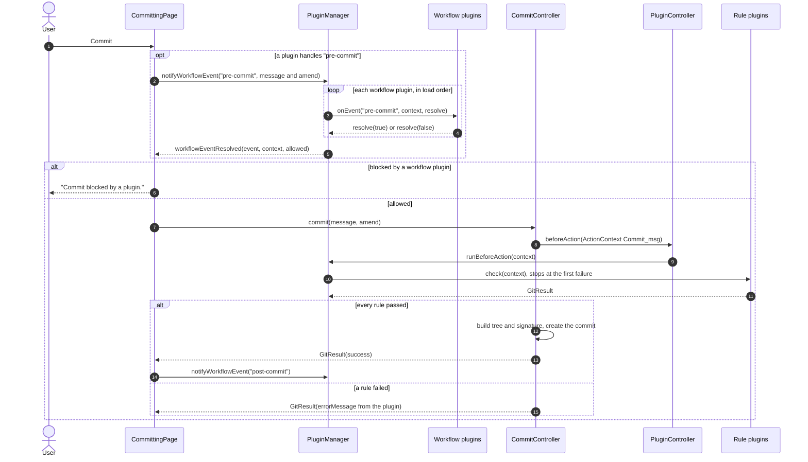

### 7.2 Push, step by step

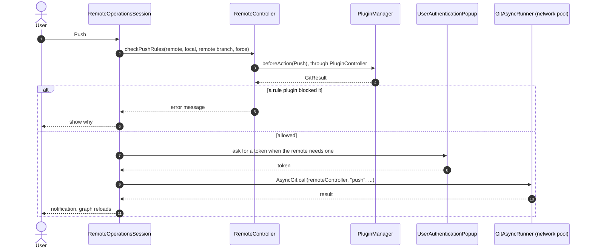

### 7.3 Conflicts, step by step

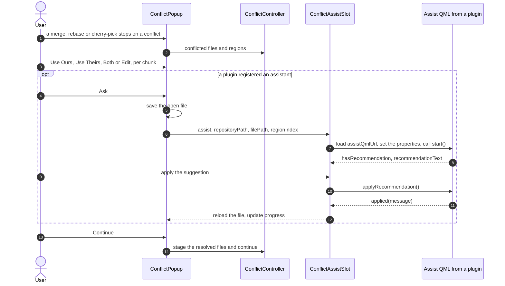

---

## 8. Plugin architecture

### 8.1 Principles

1. **The app owns the window.** A plugin offers pages, docks, viewers, menu items and buttons. The app decides where they appear.
2. **One door.** A plugin talks to the app only through [`IPluginContext`](../Src/Plugins/IPluginContext.h). It never links against the GitEase executable. Every method is pure virtual and is called through the vtable, so the same plugin `.dll` keeps working with newer GitEase builds.
3. **Add only at the end.** New methods go at the end of `IPluginContext`. New values go at the end of `ActionType`, and new fields at the end of `ActionContext`. Nothing is reordered or removed.
4. **Never block the interface.** Scans, extraction and deletion run on a worker thread. Plugins load one per event-loop turn.
5. **Change without restarting.** Install, update, enable, disable and uninstall all work while GitEase runs.
6. **A plugin is a folder.** A manifest (`plugin.json`), plus a C++ library, QML files, or both.

### 8.2 Kinds of plugin

| Kind | What you ship | What it can do | Build step |
| :-- | :-- | :-- | :-- |
| **C++ plugin** | `plugin.json` with `cppEntry`, a shared library with its QML compiled in as a Qt resource | Every extension point | CMake, same compiler and Qt as GitEase |
| **QML-only plugin** | `plugin.json` with `qmlEntry`, QML files | A dock in the utility panel (`"capabilities": ["dock"]`) | None |

### 8.3 Components

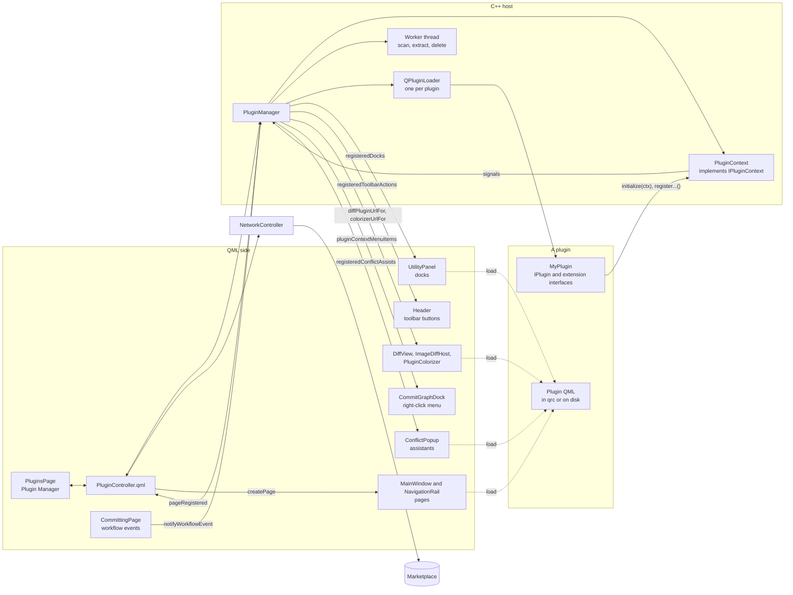

| Component | Role |
| :-- | :-- |
| [`PluginManager`](../Src/Plugins/PluginManager.h) | Finds, loads, unloads, installs and removes plugins. Keeps the lists of everything plugins registered, and exposes them to QML. Runs workflow chains and rule checks. |
| [`PluginContext`](../Src/Plugins/PluginContext.h) | The object every plugin receives. Turns `register...()` calls into signals for `PluginManager`. Holds plugin settings and the event bus. |
| [`PluginInfo`](../Src/Plugins/PluginInfo.h) | The parsed `plugin.json`, plus `enabled`, `loaded` and `errorMessage`. |
| [`PluginController.qml`](../Qml/Core/Controllers/PluginController.qml) | Creates the `PluginManager`, passes it the current repository and branch, turns plugin messages into notifications, talks to the marketplace, and tracks install progress for the Plugin Manager page. |

### 8.4 Extension points

**Core contract**

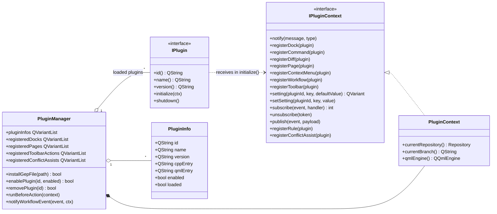

**Extension interfaces**

```mermaid
classDiagram
    direction TB
    class IPlugin {
        <<interface>>
    }
    class IDockPlugin {
        <<interface>>
        +dockQmlUrl() QUrl
        +dockTitle() QString
        +dockIcon() QString
        +defaultVisible() bool
    }
    class IPagePlugin {
        <<interface>>
        +pageId() QString
        +pageTitle() QString
        +pageIcon() QString
        +pageQmlUrl() QUrl
        +pageOrder() int
    }
    class IDiffPlugin {
        <<interface>>
        +handledExtensions() QStringList
        +diffViewerQmlUrl() QUrl
        +colorizerQmlUrl() QUrl
    }
    class IContextMenuPlugin {
        <<interface>>
        +targets() QList~MenuTarget~
        +menuItems(target, ctx) QList~MenuItem~
        +executeAction(itemId, target, ctx)
    }
    class IToolbarPlugin {
        <<interface>>
        +toolbarActions() QList~ToolbarAction~
        +onToolbarAction(actionId, ctx)
    }
    class IWorkflowPlugin {
        <<interface>>
        +handledEvents() QStringList
        +onEvent(event, context, resolve)
    }
    class ICommandPlugin {
        <<interface>>
        +commands() QList~Command~
        +execute(commandId, ctx)
    }
    class IAuthPlugin {
        <<interface>>
        +authType() QString
        +canHandle(url) bool
        +createAuth() IGitAuth
    }
    class IServicePlugin {
        <<interface>>
        +start()
        +stop()
    }
    class IRulePlugin {
        <<mix-in>>
        +check(context) GitResult
    }
    class IConflictAssistPlugin {
        <<mix-in>>
        +assistId() QString
        +assistTitle() QString
        +assistAction() QString
        +assistQmlUrl() QUrl
        +assistOrder() int
    }
    class IRepositoryAwarePlugin {
        <<mix-in>>
        +repositoryChanged(repoPath)
    }
    class ActionContext {
        +ActionType type
        +GitResult result
        +QString commitMessage
        +QString branchName
        +QStringList changedFiles
        +QString remoteName
        +bool forcePush
        +QString remoteBranchName
    }

    IPlugin <|-- IDockPlugin
    IPlugin <|-- IPagePlugin
    IPlugin <|-- IDiffPlugin
    IPlugin <|-- IContextMenuPlugin
    IPlugin <|-- IToolbarPlugin
    IPlugin <|-- IWorkflowPlugin
    IPlugin <|-- ICommandPlugin
    IPlugin <|-- IAuthPlugin
    IPlugin <|-- IServicePlugin
    IRulePlugin ..> ActionContext : checks
```

The three **mix-ins** don't derive from `IPlugin`. Your class inherits `IPlugin` (through any extension interface) and the mix-in, and lists both in `Q_INTERFACES`. A plugin can implement any number of interfaces. For example, Organization Rules is a page, a rule plugin and repository-aware at the same time.

**Reference**

| Interface | Register with | What the app does with it | Where it shows | Status |
| :-- | :-- | :-- | :-- | :-- |
| [`IPagePlugin`](../Src/Plugins/IPagePlugin.h) | `registerPage(this)` | Adds a full page, sorted by `pageOrder()` (built-in pages use 0 to 50). `--page=<pageId>` opens it at startup. | Navigation rail | Working |
| [`IDockPlugin`](../Src/Plugins/IDockPlugin.h) | `registerDock(this)` | Loads `dockQmlUrl()` in the utility panel. Searchable by title. | Utility panel | Working. `defaultVisible()` isn't read yet. |
| [`IDiffPlugin`](../Src/Plugins/IDiffPlugin.h) | `registerDiff(this)` | Maps each file extension to a viewer and/or a colorizer. Extensions are matched in lower case, and the text after the last dot is the extension (`Makefile` counts as `makefile`). | Diff view, image diff, *Browse Files at This Commit* | Working. The last plugin registered for an extension wins. |
| [`IContextMenuPlugin`](../Src/Plugins/IContextMenuPlugin.h) | `registerContextMenu(this)` | Asks `menuItems()` each time the menu opens, sorts by `order`, calls `executeAction()` on click. Context: `hash`, `branch`. | Commit graph right-click menu | Partial. The `Branch` and `File` targets aren't shown yet. |
| [`IToolbarPlugin`](../Src/Plugins/IToolbarPlugin.h) | `registerToolbar(this)` | Adds a button per action, sorted by `order`. Calls `onToolbarAction(id, ctx)`. | Main header | Working. `ctx` is empty for now. |
| [`IWorkflowPlugin`](../Src/Plugins/IWorkflowPlugin.h) | `registerWorkflow(this)` | Pre-events run as a chain: each plugin calls `resolve(true)` to continue or `resolve(false)` to stop. Post-events notify only. | Commit | Partial. Only `pre-commit` and `post-commit` are sent. Use `IRulePlugin` for push, branches, merge and checkout. |
| [`IRulePlugin`](../Src/Plugins/IRulePlugin.h) | `registerRule(this)` | Calls `check(context)` synchronously before an action. The first failed `GitResult` stops the action, and its `errorMessage` is shown. | Commit, push, branch create and delete, after checkout, after merge | Working |
| [`IConflictAssistPlugin`](../Src/Plugins/IConflictAssistPlugin.h) | `registerConflictAssist(this)` | Lists the assistant in the conflict window and loads its QML into the advisor area (contract in [8.11](#811-qml-contracts)). | Conflict window | Working |
| [`IRepositoryAwarePlugin`](../Src/Plugins/IRepositoryAwarePlugin.h) | nothing, detected automatically | Calls `repositoryChanged(path)` after loading and on every repository switch | | Working |
| [`ICommandPlugin`](../Src/Plugins/ICommandPlugin.h) | `registerCommand(this)` | Reads `commands()` and emits `commandRegistered` | Nowhere yet | Declared |
| [`IAuthPlugin`](../Src/Plugins/IAuthPlugin.h) | none | Remote operations don't ask auth plugins yet | | Declared |
| [`IServicePlugin`](../Src/Plugins/IServicePlugin.h) | none | `start()` and `stop()` are never called | | Declared. Start background work in `initialize()` and stop it in `shutdown()` instead. |

**Rule check actions** ([`ActionContext.h`](../Src/Plugins/ActionContext.h))

| `ActionType` | Sent by | Filled fields | Blocking |
| :-- | :-- | :-- | :-- |
| `Commit_msg` | `GitCommit::commit()` | `commitMessage` | Yes |
| `Push` | `GitRemote::checkPushRules()` | `remoteName`, `branchName`, `remoteBranchName`, `forcePush` | Yes |
| `BranchCreate` | `GitBranch` | `branchName` | Yes |
| `BranchDelete` | `GitBranch` | `branchName` | Yes |
| `PostCheckout` | `GitBranch` after a checkout | `branchName` | No, informational |
| `PostMerge` | `GitMerge` after a merge | `branchName` (the merged branch) | No. A plugin can return `{ "autoDeleteSourceBranch": true }` in `GitResult.data` to have the merged branch deleted. |

### 8.5 The plugin context API

| Method | Use it to | Notes |
| :-- | :-- | :-- |
| `notify(message, type)` | Show a notification | `type` is `info`, `success`, `warning` or `error` |
| `register...(this)` | Add your extension to the app | Call from `initialize()` |
| `setting(pluginId, key, defaultValue)` | Read a saved value | Stored as `pluginId/key` in `QSettings` |
| `setSetting(pluginId, key, value)` | Save a value | Saved at once |
| `subscribe(event, handler)` | Listen to an event | Returns a token |
| `unsubscribe(token)` | Stop listening | Call it in `shutdown()` |
| `publish(event, payload)` | Send an event to every listener | Handlers run on the UI thread, before `publish()` returns |

Plugin QML uses the same features through the `PluginManager` object the app passes in (see [8.11](#811-qml-contracts)):

| C++ (`IPluginContext`) | QML (`pluginManager`) |
| :-- | :-- |
| `setting()` / `setSetting()` | `pluginSetting(pluginId, key, defaultValue)` / `setPluginSetting(pluginId, key, value)` |
| `subscribe()` / `unsubscribe()` / `publish()` | `subscribeEvent(event, function(payload) {...})` / `unsubscribeEvent(token)` / `publishEvent(event, payload)` |
| | `pluginInfos`: the list of installed plugins |

### 8.6 Event bus

| Event | Sent when | Payload | Status |
| :-- | :-- | :-- | :-- |
| `repo.switched` | The current repository changes | `{}` | Working |
| `branch.changed` | The checked-out branch changes | `{ branch }` | Working |
| `commit.selected` | | | Declared in the header comment, never sent |
| `file.selected` | | | Declared in the header comment, never sent |
| Your own events | Any plugin calls `publish()` | Anything in a `QVariantMap` | Working. Prefix names with your plugin id, for example `com.acme.ci/build-finished`. |

### 8.7 The manifest: `plugin.json`

```json
{
  "id": "com.acme.branch-log",
  "name": "Branch Log",
  "version": "1.0.0",
  "apiVersion": "1",
  "capabilities": ["dock"],
  "author": "Acme",
  "description": "Logs branch switches for the open repository.",
  "cppEntry": "lib/branch-log-plugin",

  "long_description": "Shown on the plugin's details page.",
  "install_guide": "How to use the plugin after installing it.",
  "github_url": "https://github.com/acme/branch-log",
  "tags": ["branches", "log"],
  "features": [{ "title": "Live log", "description": "Every branch switch, with the time." }],
  "changelog": [{ "version": "1.0.0", "date": "2026-11-02", "notes": ["First release."] }]
}
```

| Field | Required | Meaning |
| :-- | :-- | :-- |
| `id` | Yes | Unique id in reverse-domain form. Must match `IPlugin::id()`. |
| `name` | Yes | Name shown in the Plugin Manager |
| `version` | Yes | Numbers separated by dots. When two folders hold the same `id`, the higher version loads and the other folder is deleted. |
| `cppEntry` | For C++ plugins | Library path without the extension. `lib/my-plugin` means `lib/my-plugin.dll` on Windows, `lib/libmy-plugin.so` on Linux and `lib/libmy-plugin.dylib` on macOS. A path that ends in `.dll`, `.so` or `.dylib` is used as it is. |
| `qmlEntry` | For QML-only plugins | Path of the root QML file |
| `capabilities` | No | `["dock"]` makes a QML-only plugin a dock. For C++ plugins it is informational. Use `page`, `dock`, `diff`, `contextmenu`, `toolbar`, `workflow`, `rule` or `conflict-assist`. |
| `apiVersion` | No | Use `"1"`. Not checked yet. |
| `author`, `description` | No | Shown on the plugin card |
| `icon`, `iconUrl` | No | Icon file in the package, or a URL |
| `long_description`, `install_guide`, `github_url`, `tags`, `features`, `changelog` | No | Shown on the plugin's details page |
| `minAppVersion`, `size`, `releaseDate` | No | Added by `create_gep.py`. Shown, but not checked yet. |
| `enabled` | No | Written by GitEase when the user turns the plugin on or off |

### 8.8 The package: `.gep`

A `.gep` (GitEase Package) is a ZIP file with only what the plugin needs at run time:

```text
branch-log-1.0.0.gep
├── plugin.json        manifest, with minAppVersion, size and releaseDate added
└── lib/
    └── branch-log-plugin.dll
```

- [`Scripts/create_gep.py`](../Scripts/create_gep.py) builds it: `python Scripts/create_gep.py <plugin folder> [output folder]`. It keeps `plugin.json`, the folders of `cppEntry` and `qmlEntry`, and the icon. Source files are never packed. Files are stored without compression.
- The file name is `<name as a slug>-<version>.gep`.
- When installing, entries with absolute paths or `..` are skipped, so a package can't write outside its folder.

### 8.9 Where plugins live

```text
<install folder>/plugins/                     Plugins shipped with GitEase (scanned second)
<AppData>/plugins/                            Plugins the user installed (scanned first)
├── com.acme.branch-log-1.0.0-1730541234567/  One folder per install: <id>-<version>-<timestamp>
│   ├── plugin.json
│   └── lib/
│       ├── branch-log-plugin.dll             The original library
│       └── .hot/
│           └── 1730541240000-0-branch-log-plugin.dll    The copy that is actually loaded
├── .stage_1730541234000/                     Temporary folder while a package is checked
└── old-folder/.gitease-uninstalled           Marks a locked folder for removal at the next scan
<AppData>/downloads/plugins/                  Every installed .gep is kept here for reinstalling
```

Why a hot copy: Windows locks a loaded `.dll`. Loading a copy keeps the original free, so an update can replace it and an uninstall can delete it while GitEase runs.

### 8.10 Lifecycle

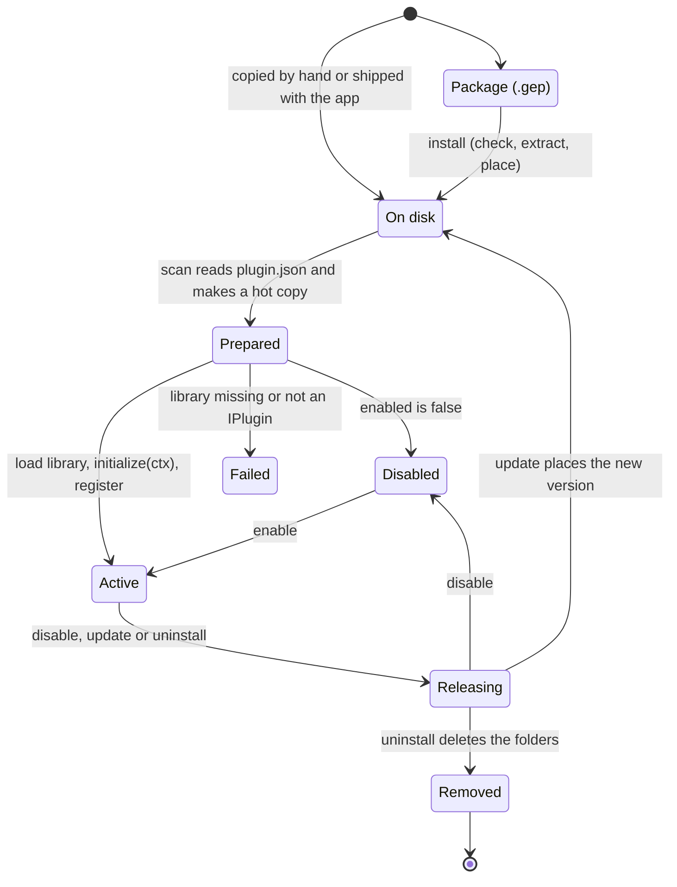

**Releasing** happens in this order, so QML never uses code that is gone:

1. Remove the plugin's docks, pages, toolbar buttons, menu items, workflow and rule hooks, diff mappings and assistants. QML unloads the plugin's items.
2. About 60 ms later, call `shutdown()`.
3. Unload the library. If it is still in use, try again every 40 ms, up to 25 times.
4. Delete the hot copy on the worker thread.

**Install from a `.gep`**

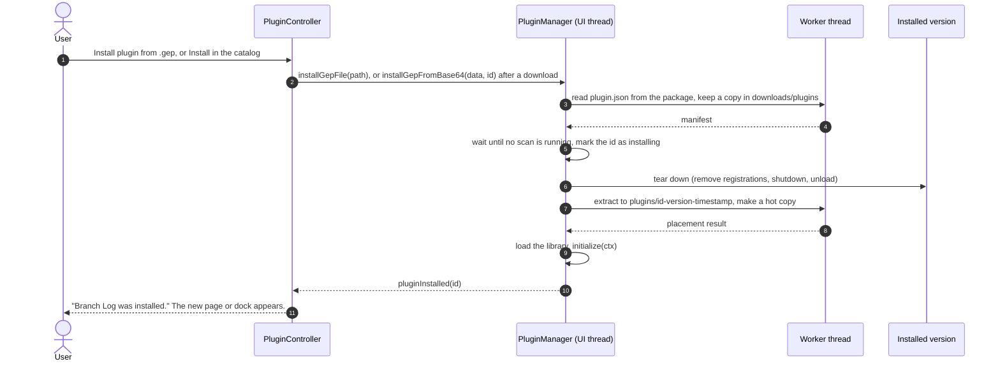

Uninstall runs the same way in reverse: tear down, then delete every folder with that `id` on the worker thread. A folder that stays locked gets a `.gitease-uninstalled` marker and is deleted at the next scan.

### 8.11 QML contracts

The app loads plugin QML with a `Loader` and fills in properties **only if your root item declares them**. Declare the ones you need.

**Properties given to pages and docks**

| Property | Type | Pages | Docks |
| :-- | :-- | :-: | :-: |
| `pluginManager`, `eventBus` | `PluginManager` (settings, events, plugin list) | ✓ | ✓ |
| `pluginId` | `string` | ✓ | ✓ |
| `pluginController` | `PluginController` | ✓ | |
| `repositoryController` | current repository: `repositoryController.appModel.currentRepository.path` and `.name` | ✓ | ✓ |
| `branchController`, `remoteController`, `commitController`, `statusController`, `tagController` | Git controllers | ✓ | ✓ |
| `stashController` | Git controller | | ✓ |
| `ignoreController`, `gitStateNotifier`, `appModel` | | ✓ | |
| `notificationController`, `guideController`, `userAuthenticationPopup`, `uiSessionPopups` | | ✓ | ✓ |
| `filterText` | `string` (the utility panel's search text) | | ✓ |

> [!TIP]
> Listen to `gitStateNotifier.repositoryChanged()` (pages) or add a `reload()` function (docks) to refresh your view after any Git change.

**Docks** look best when the root item is the app's `UtilitiesCard` (`import GitEase`). It needs `title`, `icon` and `content`, and gives you collapse, a badge (`badgeCount`) and search (`filterText`, `contentMatchesFilter`). Any other root item works too. It is then matched by title only.

**Diff viewer** (`IDiffPlugin::diffViewerQmlUrl()`): declare all four properties. The app sets them directly, for any file extension your plugin handles.

```qml
property string repositoryPath
property string filePath
property url    oldImageUrl     // the file before the change, as a temporary file
property url    newImageUrl     // the file after the change
```

**Colorizer** (`IDiffPlugin::colorizerQmlUrl()`): an invisible item with

```qml
function colorize(text, filePath)        // one line in, rich text out
function colorizeLines(lines, filePath)  // optional: the whole file, for multi-line comments and strings
```

**Conflict assistant** (`IConflictAssistPlugin::assistQmlUrl()`): the root item provides

```qml
property string repositoryPath
property string filePath
property int    regionIndex           // open conflict regions, counted from the top of the file
function start()                      // called after the app saved the file and set the properties
function dismiss()                    // cancel work in progress; don't emit dismissed()
signal applied(string message)        // the working file changed
signal dismissed()
signal failed(string message)

// Optional, for the "Use suggestion" action on a chunk:
readonly property bool   hasRecommendation
readonly property bool   busy
readonly property string recommendationText
function applyRecommendation()
```

Plugin QML can import the app's modules: `GitEase` (controllers and components such as `UtilitiesCard`), `GitEase_Style` (`Style.colors`, `Style.icons`, `Style.appFont`) and `GitEase_Style_Impl`. Use them so your plugin follows the Light, Soft and Dark themes.

### 8.12 Threads

- `initialize()`, `shutdown()`, every `register...()` call, every callback from the app (`onEvent`, `check`, `menuItems`, `executeAction`, `onToolbarAction`, `repositoryChanged`) and every event handler run on the **UI thread**.
- `check()` and `menuItems()` must return quickly. Don't do network or long disk work in them.
- `IWorkflowPlugin::onEvent()` may answer later: keep `resolve` and call it after a dialog closes or a request finishes. Call it **exactly once**. The commit waits until you do.
- For long work, use `QtConcurrent` or your own `QThread`, and send results back to the UI thread before you call the context.

### 8.13 Marketplace protocol (client side)

[`PluginController.qml`](../Qml/Core/Controllers/PluginController.qml) talks to `pluginApiBaseUrl` (today a placeholder: `http://localhost/api`).

| Request | Method and path | Used for |
| :-- | :-- | :-- |
| Categories | `GET /plugins/categories` | Category chips and colors |
| Catalog | `GET /plugins?page=<n>` with an optional search | Plugin cards, with paging |
| Details | `GET /plugins/<id>` | Details page: description, screenshots, changelog |
| Download link | `GET /plugins/<id>/download` | Returns `download_url` and `checksum_md5` |
| Package | the `download_url` | Returns `file_data_base64`, installed with `installGepFromBase64()` |
| Updates | `/plugins/check-updates` | Newer versions of installed plugins |

### 8.14 Security model

- Plugins are **fully trusted**. A C++ plugin runs in the GitEase process with the user's rights and can do anything the app can do.
- Packages are **not signed**. The MD5 checksum from the server is only checked on the older ZIP install path (`installPluginFromBase64Zip`). The `.gep` download path doesn't check it.
- Package extraction rejects absolute paths and `..`, so a package can't write outside its own folder.

---

## 9. Build your own plugin

This guide builds **Branch Log**, a dock that lists every branch switch in the open repository and remembers how many entries to keep. It then shows the code for every other kind of extension.

### 9.1 What you need

- The GitEase source code (for the SDK headers in [`Src/Plugins`](../Src/Plugins)).
- **The same Qt version and compiler as the GitEase build you test with**: Qt 6.10 and MinGW 13.1 on Windows, GCC or Clang on Linux.
- CMake 3.16 or newer.
- Python 3, to build the `.gep` package.
- A GitEase build, to try the plugin.

### 9.2 Steps

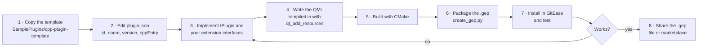

### 9.3 Folder layout

```text
branch-log/
├── CMakeLists.txt
├── plugin.json
├── BranchLogPlugin.h
├── BranchLogPlugin.cpp
└── qml/
    └── BranchLogDock.qml
```

If you start inside the GitEase repository, put the folder in [`SamplePlugins`](../SamplePlugins). The SDK is then found automatically and each build copies the plugin into the `plugins` folder of your GitEase build.

### 9.4 `plugin.json`

```json
{
  "id": "com.acme.branch-log",
  "name": "Branch Log",
  "version": "1.0.0",
  "apiVersion": "1",
  "capabilities": ["dock"],
  "author": "Acme",
  "description": "Lists every branch switch in the open repository.",
  "cppEntry": "lib/branch-log-plugin"
}
```

### 9.5 `BranchLogPlugin.h`

```cpp
#pragma once

#include <QObject>
#include "IDockPlugin.h"
#include "IRepositoryAwarePlugin.h"

class BranchLogPlugin : public QObject, public IDockPlugin, public IRepositoryAwarePlugin
{
    Q_OBJECT
    // The IID is metadata only. FILE embeds plugin.json in the library.
    Q_PLUGIN_METADATA(IID "com.gitease.IDockPlugin/1.0" FILE "plugin.json")
    // List IPlugin and every interface you implement, or the app can't find them.
    Q_INTERFACES(IPlugin IDockPlugin IRepositoryAwarePlugin)

public:
    // IPlugin: id() must match "id" in plugin.json
    QString id()      const override { return QStringLiteral("com.acme.branch-log"); }
    QString name()    const override { return QStringLiteral("Branch Log"); }
    QString version() const override { return QStringLiteral("1.0.0"); }

    void initialize(IPluginContext* ctx) override;
    void shutdown() override;

    // IDockPlugin
    QUrl    dockQmlUrl() const override { return QUrl(QStringLiteral("qrc:/com.acme.branch-log/qml/BranchLogDock.qml")); }
    QString dockTitle()  const override { return QStringLiteral("Branch Log"); }
    QString dockIcon()   const override { return QStringLiteral(""); } // Font Awesome code-branch

    // IRepositoryAwarePlugin
    void repositoryChanged(const QString& repoPath) override;

private:
    IPluginContext* m_ctx   = nullptr;
    int             m_token = -1;
};
```

### 9.6 `BranchLogPlugin.cpp`

```cpp
#include "BranchLogPlugin.h"
#include "IPluginContext.h"

void BranchLogPlugin::initialize(IPluginContext* ctx)
{
    m_ctx = ctx;
    ctx->registerDock(this);

    // C++ can listen to the event bus too. The QML below does the same thing for its own list.
    m_token = ctx->subscribe(QStringLiteral("branch.changed"), [this](const QVariantMap& payload) {
        const int switches = m_ctx->setting(id(), QStringLiteral("switches"), 0).toInt() + 1;
        m_ctx->setSetting(id(), QStringLiteral("switches"), switches);
        Q_UNUSED(payload)
    });
}

void BranchLogPlugin::shutdown()
{
    if (m_ctx && m_token >= 0)
        m_ctx->unsubscribe(m_token);
    m_token = -1;
    m_ctx = nullptr;
}

void BranchLogPlugin::repositoryChanged(const QString& repoPath)
{
    Q_UNUSED(repoPath) // called after loading and on every repository switch
}
```

### 9.7 `qml/BranchLogDock.qml`

```qml
import QtQuick
import QtQuick.Controls
import QtQuick.Layouts

import GitEase
import GitEase_Style

UtilitiesCard {
    id: root

    // Filled in by GitEase when the dock loads (section 8.11)
    property var    pluginManager: null
    property string pluginId: ""
    property var    repositoryController: null

    readonly property string repoName: repositoryController?.appModel?.currentRepository?.name ?? ""
    readonly property int    maxEntries: pluginManager ? pluginManager.pluginSetting(pluginId, "maxEntries", 20) : 20

    property var entries: []
    property int token: -1

    title: "Branch Log"
    icon: Style.icons.branch
    badgeCount: entries.length > 0 ? entries.length : -1
    contentMatchesFilter: entries.some(e => e.toLowerCase().includes(filterNeedle))

    function add(text) {
        entries = [new Date().toLocaleTimeString() + "  " + text].concat(entries).slice(0, maxEntries)
    }

    onPluginManagerChanged: {
        if (!pluginManager || token >= 0)
            return
        token = pluginManager.subscribeEvent("branch.changed", payload => root.add(payload.branch))
    }

    Component.onDestruction: {
        if (pluginManager && token >= 0)
            pluginManager.unsubscribeEvent(token)
    }

    content: ColumnLayout {
        spacing: 4

        Label {
            text: root.repoName.length > 0 ? root.repoName : "No repository open"
            color: Style.colors.mutedText
            font.pointSize: Style.appFont.smallPt
        }

        Repeater {
            model: root.entries
            delegate: Label {
                required property string modelData
                text: modelData
                color: Style.colors.utilitiesRowText
                font.pointSize: Style.appFont.smallPt
            }
        }
    }
}
```

### 9.8 `CMakeLists.txt`

```cmake
cmake_minimum_required(VERSION 3.16)
project(BranchLogPlugin VERSION 1.0.0 LANGUAGES CXX)

set(CMAKE_CXX_STANDARD 17)
set(CMAKE_CXX_STANDARD_REQUIRED ON)
set(CMAKE_AUTOMOC ON)

find_package(Qt6 REQUIRED COMPONENTS Core Quick)

# The SDK is GitEase's Src/Plugins folder. Inside SamplePlugins it is found automatically.
if(NOT GITEASE_SDK_DIR)
    get_filename_component(GITEASE_SDK_DIR "${CMAKE_CURRENT_SOURCE_DIR}/../../Src/Plugins" ABSOLUTE)
endif()
if(NOT EXISTS "${GITEASE_SDK_DIR}/IPlugin.h")
    message(FATAL_ERROR "Pass -DGITEASE_SDK_DIR=<path to GitEase>/Src/Plugins")
endif()
set(GITEASE_SRC_DIR "${GITEASE_SDK_DIR}/..")

add_library(branch-log-plugin SHARED
    BranchLogPlugin.h
    BranchLogPlugin.cpp
)

# GitEase loads lib/branch-log-plugin.dll on Windows and lib/libbranch-log-plugin.so on Linux.
# MinGW adds a "lib" prefix by default, so remove it on Windows only.
if(WIN32)
    set_target_properties(branch-log-plugin PROPERTIES PREFIX "")
endif()

# The QML goes inside the library, under qrc:/com.acme.branch-log/
qt_add_resources(branch-log-plugin "branch_log_qml"
    PREFIX "/com.acme.branch-log"
    FILES qml/BranchLogDock.qml
)

target_include_directories(branch-log-plugin PRIVATE
    ${GITEASE_SDK_DIR}
    ${GITEASE_SRC_DIR}/Git           # only for IRulePlugin / ActionContext (GitResult.h)
)
target_link_libraries(branch-log-plugin PRIVATE Qt6::Core Qt6::Quick)

# Put the library where cppEntry points: <plugin folder>/lib/
add_custom_command(TARGET branch-log-plugin POST_BUILD
    COMMAND ${CMAKE_COMMAND} -E make_directory "${CMAKE_CURRENT_SOURCE_DIR}/lib"
    COMMAND ${CMAKE_COMMAND} -E copy_if_different "$<TARGET_FILE:branch-log-plugin>" "${CMAKE_CURRENT_SOURCE_DIR}/lib/"
)
```

If your plugin uses `IRulePlugin` or `ActionContext`, also add these two lines. `GitResult` is a `Q_GADGET`, so it needs moc in your library, without the QML registration the app already does:

```cmake
target_compile_definitions(branch-log-plugin PRIVATE GITEASE_SKIP_QML_ELEMENT)
target_sources(branch-log-plugin PRIVATE ${GITEASE_SRC_DIR}/Git/GitResult.h)
```

Inside [`SamplePlugins`](../SamplePlugins) you can replace the custom command with the shared helper, which also writes the `.gep` on every build:

```cmake
include("${CMAKE_CURRENT_SOURCE_DIR}/../PackageGep.cmake")
gitease_package_gep(branch-log-plugin)
```

### 9.9 Build, package and install

```bash
# 1. Build (use the same Qt kit and compiler as GitEase)
cmake -S branch-log -B branch-log/build -G Ninja \
      -DCMAKE_PREFIX_PATH=<Qt>/6.10.x/<kit> \
      -DGITEASE_SDK_DIR=<GitEase>/Src/Plugins
cmake --build branch-log/build

# 2. Package: writes branch-log/branch-log-1.0.0.gep
python <GitEase>/Scripts/create_gep.py branch-log
```

Then install it in one of three ways:

- **Plugin Manager**: choose **Install plugin from .gep** and pick the file.
- **Copy the folder**: copy `plugin.json` and `lib/` to `<AppData>/plugins/branch-log/`, then restart GitEase or rescan in the Plugin Manager.
- **Development build**: copy them to `plugins/branch-log/` next to the `GitEase` executable in your build folder. The sample plugins' CMake files do this after every build.

To work on the plugin, rebuild and choose **Install plugin from .gep** again. The old version is unloaded and the new one loads, without restarting GitEase.

### 9.10 Recipes for the other extension points

Each recipe shows the parts that differ from Branch Log: the header's base classes and `Q_INTERFACES`, and the methods to implement.

#### Page

```cpp
class CiPagePlugin : public QObject, public IPagePlugin
{
    Q_OBJECT
    Q_PLUGIN_METADATA(IID "com.gitease.IPagePlugin/1.0" FILE "plugin.json")
    Q_INTERFACES(IPlugin IPagePlugin)
public:
    // id(), name(), version(), shutdown() as in Branch Log
    void    initialize(IPluginContext* ctx) override { ctx->registerPage(this); }
    QString pageId()     const override { return QStringLiteral("com.acme.ci"); }  // also used by --page=
    QString pageTitle()  const override { return QStringLiteral("CI"); }
    QString pageIcon()   const override { return QStringLiteral(""); }       // Font Awesome bolt
    QUrl    pageQmlUrl() const override { return QUrl(QStringLiteral("qrc:/com.acme.ci/qml/CiPage.qml")); }
    int     pageOrder()  const override { return 80; }                             // after built-in pages
};
```

The page QML declares the host properties it needs, for example `property var gitStateNotifier` and `property var repositoryController`.

#### Context-menu item

```cpp
#include <QDesktopServices>   // link Qt6::Gui
#include "IContextMenuPlugin.h"

class OpenOnWebPlugin : public QObject, public IContextMenuPlugin
{
    Q_OBJECT
    Q_PLUGIN_METADATA(IID "com.gitease.IContextMenuPlugin/1.0" FILE "plugin.json")
    Q_INTERFACES(IPlugin IContextMenuPlugin)
public:
    void initialize(IPluginContext* ctx) override { m_ctx = ctx; ctx->registerContextMenu(this); }

    QList<MenuTarget> targets() const override { return { MenuTarget::CommitGraph }; }

    QList<MenuItem> menuItems(MenuTarget, const QVariantMap&) const override
    {
        // id, label, icon, separator, order
        return { { QStringLiteral("open-web"), QStringLiteral("Open Commit on the Web"), QString(), false, 50 } };
    }

    void executeAction(const QString& itemId, MenuTarget, const QVariantMap& ctx) override
    {
        if (itemId == QStringLiteral("open-web"))
            QDesktopServices::openUrl(QUrl(QStringLiteral("https://example.com/commit/") + ctx.value("hash").toString()));
    }
private:
    IPluginContext* m_ctx = nullptr;
};
```

`ctx` holds `hash` and `branch`. Only the commit graph menu shows plugin items today.

#### Toolbar button

```cpp
class SyncAllPlugin : public QObject, public IToolbarPlugin
{
    Q_OBJECT
    Q_PLUGIN_METADATA(IID "com.gitease.IToolbarPlugin/1.0" FILE "plugin.json")
    Q_INTERFACES(IPlugin IToolbarPlugin)
public:
    void initialize(IPluginContext* ctx) override { m_ctx = ctx; ctx->registerToolbar(this); }

    QList<ToolbarAction> toolbarActions() const override
    {
        // id, tooltip, icon, order
        return { { QStringLiteral("sync"), QStringLiteral("Sync all"), QStringLiteral(""), 100 } };
    }

    void onToolbarAction(const QString& actionId, const QVariantMap&) override
    {
        if (actionId == QStringLiteral("sync"))
            m_ctx->notify(QStringLiteral("Syncing..."), QStringLiteral("info"));
    }
private:
    IPluginContext* m_ctx = nullptr;
};
```

#### Workflow: allow or block a commit

From the [Commit Guard](../SamplePlugins/commit-guard-plugin) sample:

```cpp
class CommitGuardPlugin : public QObject, public IWorkflowPlugin
{
    Q_OBJECT
    Q_PLUGIN_METADATA(IID "com.gitease.IWorkflowPlugin/1.0" FILE "plugin.json")
    Q_INTERFACES(IPlugin IWorkflowPlugin)
public:
    void initialize(IPluginContext* ctx) override { m_ctx = ctx; ctx->registerWorkflow(this); }

    QStringList handledEvents() const override { return { QStringLiteral("pre-commit") }; }

    void onEvent(const QString& event, const QVariantMap& context,
                 std::function<void(bool)> resolve) override
    {
        const QString message = context.value(QStringLiteral("message")).toString().trimmed();
        if (message.length() < 10) {
            m_ctx->notify(QStringLiteral("Commit blocked: the message is too short."), QStringLiteral("warning"));
            resolve(false);   // block
            return;
        }
        resolve(true);        // allow. Call resolve exactly once, now or later.
    }
private:
    IPluginContext* m_ctx = nullptr;
};
```

`pre-commit` gets `message` and `amend`. `post-commit` gets `amend`.

#### Rule: check commits, pushes and branches

A rule plugin is checked synchronously before the action. It works for commits, pushes, branch creation and deletion, and after checkouts and merges.

```cpp
#include "IPagePlugin.h"   // any IPlugin-based interface, here a page for the rule settings
#include "IRulePlugin.h"

class ProtectMainPlugin : public QObject, public IPagePlugin, public IRulePlugin
{
    Q_OBJECT
    Q_PLUGIN_METADATA(IID "com.gitease.IPagePlugin/1.0" FILE "plugin.json")
    Q_INTERFACES(IPlugin IPagePlugin IRulePlugin)
public:
    void initialize(IPluginContext* ctx) override
    {
        ctx->registerPage(this);
        ctx->registerRule(this);
    }

    // IPagePlugin methods...

    GitResult check(ActionContext* context) override
    {
        if (context->type == ActionType::Push
            && context->forcePush
            && context->remoteBranchName == QStringLiteral("main"))
        {
            return GitResult(false, {}, QStringLiteral("Force push to main is not allowed."));
        }

        if (context->type == ActionType::BranchDelete && context->branchName == QStringLiteral("develop"))
            return GitResult(false, {}, QStringLiteral("develop is protected."));

        return GitResult(true);   // allow
    }
};
```

Remember the two CMake lines for `GitResult` in [9.8](#98-cmakeliststxt). A rule plugin doesn't need a page: `class MyRules : public QObject, public IPlugin, public IRulePlugin` with `Q_INTERFACES(IPlugin IRulePlugin)` works too, as long as `initialize()` calls `registerRule(this)`.

#### Diff viewer or colorizer

```cpp
class PdfDiffPlugin : public QObject, public IDiffPlugin
{
    Q_OBJECT
    Q_PLUGIN_METADATA(IID "com.gitease.IDiffPlugin/1.0" FILE "plugin.json")
    Q_INTERFACES(IPlugin IDiffPlugin)
public:
    void        initialize(IPluginContext* ctx) override { ctx->registerDiff(this); }
    QStringList handledExtensions() const override { return { QStringLiteral("pdf") }; }  // lower case, no dot
    QUrl        diffViewerQmlUrl()  const override { return QUrl(QStringLiteral("qrc:/com.acme.pdf-diff/qml/PdfDiff.qml")); }
    // or: QUrl colorizerQmlUrl() const override { ... } for syntax colors
};
```

The viewer and colorizer QML contracts are in [8.11](#811-qml-contracts). If your QML needs a C++ type, register it in `initialize()`, as [Syntax Colors](../SamplePlugins/syntax-colors/SyntaxColorsPlugin.cpp) does:

```cpp
qmlRegisterType<SyntaxColorizer>("GitEaseSyntaxColors", 1, 0, "SyntaxColorizer");
```

#### Conflict assistant

```cpp
class MergeHelperPlugin : public QObject, public IDockPlugin, public IConflictAssistPlugin
{
    Q_OBJECT
    Q_PLUGIN_METADATA(IID "com.gitease.IDockPlugin/1.0" FILE "plugin.json")
    Q_INTERFACES(IPlugin IDockPlugin IConflictAssistPlugin)
public:
    void initialize(IPluginContext* ctx) override
    {
        ctx->registerDock(this);            // optional: settings for the assistant
        ctx->registerConflictAssist(this);
    }

    QString assistId()     const override { return QStringLiteral("merge-helper"); }
    QString assistTitle()  const override { return QStringLiteral("Merge Helper"); }
    QString assistAction() const override { return QStringLiteral("Suggest"); }   // button text
    QUrl    assistQmlUrl() const override { return QUrl(QStringLiteral("qrc:/com.acme.merge-helper/qml/Assist.qml")); }
    int     assistOrder()  const override { return 50; }
};
```

#### QML-only dock (no build step)

```text
my-qml-dock/
├── plugin.json
└── qml/
    └── MyDock.qml
```

```json
{
  "id": "com.acme.my-qml-dock",
  "name": "My QML Dock",
  "version": "1.0.0",
  "capabilities": ["dock"],
  "qmlEntry": "qml/MyDock.qml"
}
```

The dock's title is the plugin `name`. Package it with `create_gep.py` like any other plugin. QML-only plugins can only add docks today.

### 9.11 Compatibility rules

| Rule | Why |
| :-- | :-- |
| Build with the **same Qt version** (major and minor) and the **same compiler** as the GitEase you target. On Windows that is MinGW 64-bit, never MSVC. | `QString`, `QVariantMap` and `std::function` cross the boundary between the app and the plugin. |
| Include only the headers in `Src/Plugins` (plus `Src/Git/GitResult.h` for rule plugins). Don't link against the GitEase executable. | Plugins call the app only through the `IPluginContext` vtable. |
| Return the same `id` from `IPlugin::id()` as in `plugin.json`. | The app finds, enables and removes plugins by this `id`. |
| List every interface in `Q_INTERFACES`, starting with `IPlugin`. | The app uses `qobject_cast<IPlugin*>`, then `dynamic_cast` for the others. |
| Undo everything in `shutdown()`: unsubscribe from events, stop timers and threads, close files. | The library is unloaded right after `shutdown()`. Code left running crashes the app. |
| Keep QML inside the library with `qt_add_resources`, under a prefix equal to your `id`. | Two plugins can't clash on file names, and nothing has to be read from disk. |

### 9.12 Troubleshooting

| What you see | Likely cause | Fix |
| :-- | :-- | :-- |
| "Library not found: …" | The file in `lib/` doesn't match `cppEntry` | Check the name and prefix rules in [8.7](#87-the-manifest-pluginjson) and the `PREFIX` setting in [9.8](#98-cmakeliststxt). |
| "Object does not implement IPlugin" | `IPlugin` is missing from `Q_INTERFACES`, or `Q_PLUGIN_METADATA` is missing | Add both, as in [9.5](#95-branchlogpluginh). |
| The plugin fails to load with a Qt error | Different Qt version or compiler | Rebuild with the same kit as GitEase. |
| The plugin isn't listed at all | `plugin.json` is invalid, or `id`, `name` or `version` is missing | Validate the JSON. All three fields are required. |
| The dock or page is empty | Wrong `qrc:` URL | The URL is `qrc:/<PREFIX>/<path in FILES>`. Check the QML for errors in the console output. |
| Host properties are `null` in QML | The property isn't declared on the root item | Declare it with the exact name from [8.11](#811-qml-contracts). |
| The commit never happens | A workflow plugin didn't call `resolve` | Call `resolve` on every path, once. |
| GitEase crashes when the plugin is disabled | Work still running after `shutdown()` | Stop timers, threads and subscriptions in `shutdown()`. |

---

## 10. Build and deployment

### 10.1 Build targets

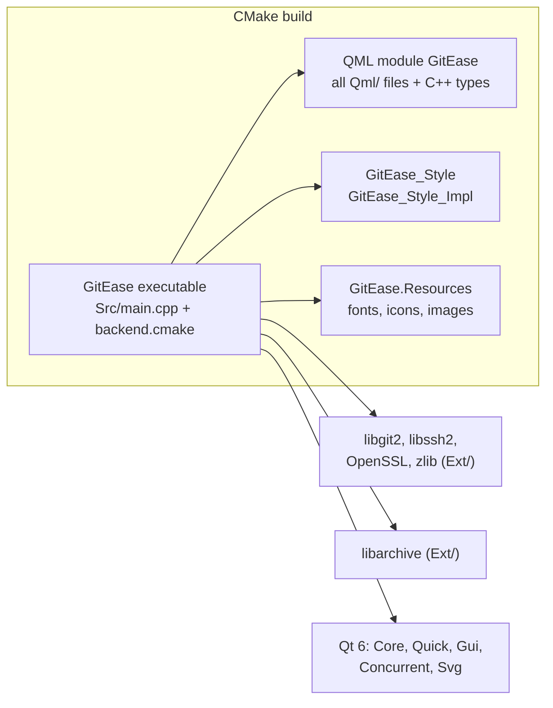

| File | What it defines |
| :-- | :-- |
| [`CMakeLists.txt`](../CMakeLists.txt) | Project (version 0.9.0), executable, QML module `GitEase`, install rules, tests |
| [`backend.cmake`](../backend.cmake) | Every C++ source and header, and the include folders |
| [`Resources.cmake`](../Resources.cmake) | Every QML file, grouped by folder |
| [`libgit.cmake`](../libgit.cmake), [`libarchive.cmake`](../libarchive.cmake) | Imported targets for the prebuilt libraries in `Ext/` |
| [`packaging.cmake`](../packaging.cmake) | CPack settings for the Linux `.deb` |

Debug builds turn off QML cache generation so QML Preview works.

### 10.2 Deployment

| Platform | Script | Output |
| :-- | :-- | :-- |
| Windows | [`Scripts/Build-Release.ps1`](../Scripts/Build-Release.ps1) (`-Zip`, `-Installer`) | `dist\GitEase-Release`, a `.zip`, and a `Setup.exe` from [`installer/GitEase.iss`](../installer/GitEase.iss) (Inno Setup 6) |
| Linux | [`Scripts/build.sh`](../Scripts/build.sh) | `build/release` and a `.deb` |

The app checks `https://gitease.app/api` for updates at startup, downloads the installer and starts it (**Settings → Updates**).

---

## 11. Glossary

| Term | Meaning |
| :-- | :-- |
| **Host** | The GitEase app, when talking about plugins |
| **Plugin** | A folder with `plugin.json`, and a C++ library, QML files, or both, that GitEase loads at run time |
| **SDK** | The plugin headers in [`Src/Plugins`](../Src/Plugins) |
| **Extension point** | An interface a plugin implements to add something to GitEase, for example `IDockPlugin` |
| **Mix-in** | An extension interface that doesn't derive from `IPlugin`: `IRulePlugin`, `IConflictAssistPlugin`, `IRepositoryAwarePlugin` |
| **`.gep`** | GitEase Package: a ZIP file with a plugin's manifest and run-time files |
| **Manifest** | `plugin.json` |
| **Hot copy** | The copy of a plugin library that is actually loaded, so the original can be replaced or deleted |
| **Controller** | A QML object, usually on top of a C++ class, that does one kind of work (branches, commits, plugins, ...) |
| **UiSession** | The object that creates and wires all controllers for one window |
| **Lane** | The queue of Git jobs for one repository. Jobs in a lane run one at a time. |
| **Utility panel** | The side panel with filterable docks (Remotes, Branches, Stashes, plugin docks, ...) |
| **Dock** | A collapsible card in the utility panel |
| **Page** | A full screen reached from the navigation rail |
| **Event bus** | Named events that the app and plugins publish and subscribe to |
| **Rule check** | A synchronous plugin check before an action, through `IRulePlugin` and `ActionContext` |
| **Workflow event** | A plugin hook around an operation (`pre-commit`, `post-commit`), through `IWorkflowPlugin` |
